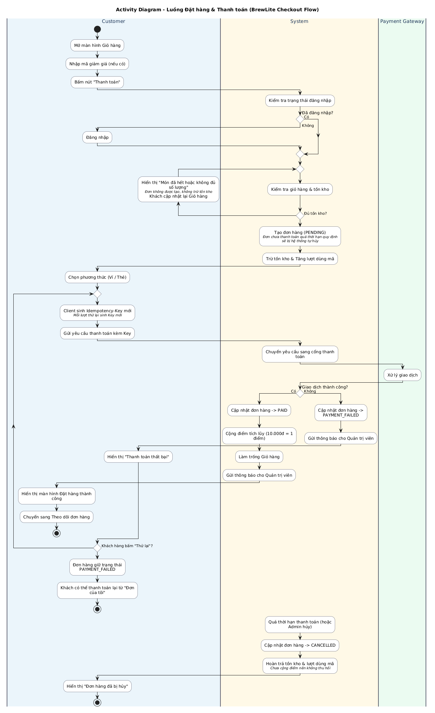
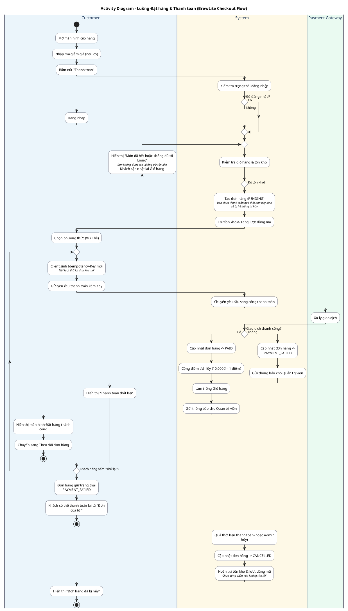

# Đặc tả Sơ đồ Hoạt động (Activity Diagram) – Luồng Đặt hàng & Thanh toán BrewLite

> **Tệp tài liệu:** `docs/architecture/activity-checkout.md`
> **Tạo phẩm liên quan:** `docs/diagrams/activity-checkout.puml`, `docs/diagrams/activity-checkout.png`, `docs/diagrams/activity-checkout.svg`
> **Nhiệm vụ:** Task 2.1 – Activity diagram (Assignment 2)
> **Phạm vi:** Đặt đơn hàng, thanh toán đơn hàng, xử lý thanh toán thất bại và hủy đơn

---

## 1. Mục tiêu và phạm vi

Sơ đồ mô tả luồng hoạt động end-to-end từ lúc khách hàng bấm "Thanh toán" tại giỏ hàng đến khi đơn được thanh toán thành công, hoặc đơn bị hủy. Sơ đồ trả lời câu hỏi "ai làm gì, theo thứ tự nào, rẽ nhánh khi nào".

Sơ đồ thể hiện đủ các yêu cầu của Task 2.1:

- có điểm bắt đầu và các điểm kết thúc (thanh toán thành công, đơn giữ `PAYMENT_FAILED`, đơn bị hủy);
- phân làn theo ba tác nhân: **Customer**, **System**, **Payment Gateway**;
- có các nút quyết định (rẽ nhánh **Có** hoặc **Không**) và vòng lặp cho nhánh thành công và thất bại;
- có đủ ba tình huống bắt buộc: **chưa đăng nhập**, **hết hàng**, **thanh toán thất bại**.

---

## 2. Sơ đồ hoạt động





---

## 3. Các làn trách nhiệm (Swimlane)

| Làn | Vai trò trong luồng | Hoạt động chính |
|---|---|---|
| **Customer** (khách hàng, giao diện web/PWA) | Khởi tạo và hoàn tất các thao tác của người dùng | Mở giỏ, nhập mã giảm giá, bấm "Thanh toán", đăng nhập, cập nhật giỏ, chọn Ví/Thẻ, sinh `Idempotency-Key`, gửi yêu cầu thanh toán, xem kết quả, bấm "Thử lại" |
| **System** (BrewLite) | Kiểm tra nghiệp vụ, ghi nhận dữ liệu, điều phối thanh toán | Kiểm tra đăng nhập, giỏ hàng và tồn kho, tạo đơn, trừ tồn kho, chuyển yêu cầu sang cổng thanh toán, cập nhật trạng thái đơn, tích điểm, làm trống giỏ, thông báo cho quản trị viên, hủy đơn (quá hạn thanh toán hoặc Admin hủy) và hoàn trả |
| **Payment Gateway** (cổng thanh toán mô phỏng) | Xử lý giao dịch Ví/Thẻ | Nhận yêu cầu, xử lý và trả kết quả thành công hoặc thất bại |

---

## 4. Thuyết minh luồng xử lý

### 4.1. Khởi động và kiểm tra đăng nhập

1. Khách hàng mở giỏ hàng, nhập mã giảm giá nếu có, rồi bấm "Thanh toán".
2. Hệ thống kiểm tra trạng thái đăng nhập.
   - **Có** (đã đăng nhập): đi tiếp trực tiếp.
   - **Không** (chưa đăng nhập): khách được chuyển sang đăng nhập, sau đó quay lại luồng và tiếp tục kiểm tra giỏ hàng.

### 4.2. Kiểm tra giỏ hàng và tồn kho

3. Hệ thống kiểm tra từng món trong giỏ (còn bán, đủ số lượng) để hai khách cùng mua món cuối không làm tồn kho âm.
4. **Không đủ tồn kho (tình huống hết hàng):** đơn không được tạo và không món nào bị trừ tồn kho. Khách thấy thông báo "Món đã hết hoặc không đủ số lượng" và cập nhật lại giỏ hàng. Luồng **quay lại bước 3** để kiểm tra lại giỏ hàng mới; vòng này lặp đến khi mọi món đều đủ số lượng.

### 4.3. Tạo đơn

5. Khi đủ tồn kho, hệ thống tạo đơn ở trạng thái `PENDING` (Chờ thanh toán), trừ số lượng tồn kho và tăng lượt dùng của mã giảm giá nếu có áp dụng.
6. Đơn chưa thanh toán mà quá thời hạn quy định sẽ bị hệ thống tự hủy (xem bước 14).
7. Khách chọn phương thức thanh toán: Ví hoặc Thẻ.

### 4.4. Vòng lặp thanh toán

8. Ứng dụng phía khách sinh một `Idempotency-Key` và gửi yêu cầu thanh toán kèm khóa này. Khi khách bấm "Thử lại", một khóa **mới** được sinh. Khi cùng một lần thanh toán bị gửi lặp (bấm đúp, mạng chậm), khóa giữ nguyên nên hệ thống nhận ra và chỉ tính tiền một lần.
9. Hệ thống chuyển yêu cầu sang cổng thanh toán; cổng xử lý giao dịch và trả kết quả.
10. **Giao dịch thành công (Có):**
    - đơn chuyển `PAID`;
    - cộng điểm tích lũy theo quy tắc 10.000đ = 1 điểm;
    - làm trống giỏ hàng;
    - gửi thông báo cho quản trị viên;
    - khách thấy màn hình "Đặt hàng thành công" và được chuyển sang theo dõi đơn hàng. **Kết thúc luồng.**
11. **Giao dịch thất bại (Không):**
    - đơn chuyển `PAYMENT_FAILED`;
    - gửi thông báo cho quản trị viên;
    - khách thấy "Thanh toán thất bại".
12. **Khách bấm "Thử lại" (Có):** quay lại bước 8 với khóa mới (có thể đổi phương thức).

### 4.5. Khách không thử lại và nhánh hủy đơn

13. **Khách không bấm "Thử lại" (Không):** hệ thống không hủy đơn ngay. Đơn giữ trạng thái `PAYMENT_FAILED`; khách có thể thanh toán lại từ "Đơn của tôi". **Kết thúc nhánh này.**
14. **Nhánh hủy đơn (xử lý ngầm định):** đơn chưa thanh toán bị hủy khi quá thời hạn thanh toán hoặc khi Admin hủy. Hệ thống cập nhật đơn sang `CANCELLED`, hoàn trả tồn kho và lượt dùng mã giảm giá. Do đơn chưa thanh toán thành công nên chưa cộng điểm và không cần thu hồi điểm. Khách thấy "Đơn hàng đã bị hủy". **Kết thúc luồng.**

Nhánh hủy đơn không nối bằng mũi tên từ các bước trên vì việc hủy xảy ra theo thời gian hoặc do Admin, độc lập với thao tác của khách.

---

## 5. Các nút quyết định (Decision)

Mỗi nút quyết định trên sơ đồ có hai nhánh **Có** và **Không**, được mô tả trong bảng sau.

| Nút quyết định | Điều kiện | Nhánh "Có" | Nhánh "Không" |
|---|---|---|---|
| Đã đăng nhập? | Khách có phiên đăng nhập hợp lệ | Tiếp tục kiểm tra giỏ hàng | Khách đăng nhập rồi tiếp tục |
| Đủ tồn kho? | Mọi món trong giỏ còn đủ số lượng | Tạo đơn `PENDING` | Báo hết hàng, khách cập nhật giỏ, **quay lại bước kiểm tra giỏ hàng & tồn kho** |
| Giao dịch thành công? | Cổng thanh toán xác nhận thành công | Đơn `PAID`, kết thúc thành công | Đơn `PAYMENT_FAILED`, báo lỗi cho khách |
| Khách bấm "Thử lại"? | Khách chọn thanh toán lại | Quay lại vòng lặp thanh toán | Đơn giữ `PAYMENT_FAILED`; khách có thể thanh toán lại từ "Đơn của tôi" |

---

## 6. Các kịch bản ngoại lệ cốt lõi

| Tình huống | Vị trí trên sơ đồ | Kết quả |
|---|---|---|
| Chưa đăng nhập | Nút "Đã đăng nhập?" nhánh "Không" | Khách đăng nhập rồi quay lại luồng đặt đơn |
| Hết hàng | Nút "Đủ tồn kho?" nhánh "Không" | Báo món hết hoặc không đủ số lượng; khách cập nhật giỏ; không tạo đơn, không trừ tồn kho; kiểm tra lại giỏ mới |
| Thanh toán thất bại | Nút "Giao dịch thành công?" nhánh "Không" và nút "Khách bấm Thử lại?" | Đơn `PAYMENT_FAILED`; khách thử lại với khóa mới, hoặc thanh toán lại sau từ "Đơn của tôi"; đơn bị hủy khi quá hạn thanh toán hoặc Admin hủy |

Các ngoại lệ chi tiết hơn (mã giảm giá không dùng được, thanh toán quá thời gian chờ chưa rõ kết quả) được mô tả ở `usecase-checkout.md` và `sequence-checkout.md`, không vẽ lại ở đây để sơ đồ dễ đọc.

---

## 7. Trạng thái đơn hàng đi qua luồng

```text
   (Tạo đơn)
       │
       ▼
  [ PENDING ] ─────────────(Thành công)─────────────► [ PAID ] ──► (Theo dõi đơn)
       │                                                  ▲
       │ (Thất bại)                                       │ (Thanh toán lại thành công)
       ▼                                                  │
 [ PAYMENT_FAILED ] ──────────────────────────────────────┘
       │
       │ (Quá hạn thanh toán hoặc Admin hủy)
       ▼
  [ CANCELLED ] ───────────────► (Kết thúc luồng)

  (PENDING cũng chuyển sang CANCELLED khi quá hạn thanh toán hoặc Admin hủy)
```

*(Ghi chú: Sơ đồ mô tả phạm vi từ lúc đặt đơn đến khi thanh toán thành công hoặc đơn bị hủy khi chưa thanh toán. Quy trình pha chế và giao nhận đồ uống sau trạng thái `PAID` không thuộc phạm vi của sơ đồ hoạt động này.)*

---

## 8. Ma trận truy vết yêu cầu (Traceability Matrix)

Cột **Mã Yêu cầu** ghi mã yêu cầu chức năng (FR-xx) và yêu cầu phi chức năng (NFR-xx) mà hoạt động đáp ứng; cột **Mã Tiêu chí chấp nhận** ghi mã AC trong `srs.md` dùng để kiểm chứng hoạt động đó (AC-xx.y cho FR, AC-Nxx.y cho NFR).

| Hoạt động trên sơ đồ | Mã Yêu cầu (FR) | Mã Tiêu chí chấp nhận (AC) | Mô tả kết quả |
|---|---|---|---|
| Mở giỏ, nhập mã giảm giá, bấm "Thanh toán" | FR-03, FR-05 | AC-03.4, AC-05.8 – AC-05.11 | Khách bắt đầu quy trình thanh toán; mã giảm giá (nếu có) được ghi nhận cho đơn |
| Kiểm tra đăng nhập, đăng nhập | FR-03, FR-04; NFR-02 | AC-03.9, AC-04.5, AC-04.8, AC-04.9, AC-N02.4 | Khách chưa đăng nhập được yêu cầu đăng nhập trước khi tiếp tục; khách đã đăng nhập đi tiếp |
| Kiểm tra tồn kho, báo hết hàng, kiểm tra lại | FR-05; NFR-03, NFR-05 | AC-05.4, AC-05.13, AC-N05.2, AC-N03.4 | Món không đủ số lượng bị từ chối kèm thông báo; không tạo đơn và không trừ tồn kho; hai khách cùng mua món cuối thì chỉ một khách đặt được |
| Tạo đơn `PENDING`, trừ tồn kho, tăng lượt dùng mã | FR-05; NFR-05 | AC-05.1, AC-05.2, AC-05.3, AC-05.12, AC-N05.1 | Đơn được tạo ở trạng thái Chờ thanh toán; tồn kho giảm đúng số lượng đặt; lượt dùng mã tăng thêm 1 nếu có áp dụng |
| Chọn phương thức, gửi yêu cầu kèm `Idempotency-Key` | FR-06; NFR-05 | AC-06.7, AC-06.11, AC-N05.3 | Mỗi lần thanh toán có một khóa riêng; gửi lặp cùng khóa chỉ bị tính tiền một lần |
| Thanh toán thành công | FR-06; NFR-02 | AC-06.1, AC-06.2, AC-06.3, AC-06.4, AC-N02.5 | Đơn chuyển `PAID`; điểm tích lũy được cộng; giỏ hàng được làm trống; quản trị viên được thông báo; khách thấy màn hình đặt hàng thành công |
| Thanh toán thất bại và thử lại | FR-06, FR-07; NFR-03, NFR-05 | AC-06.5, AC-06.6, AC-06.13, AC-07.7, AC-N03.4 | Đơn chuyển `PAYMENT_FAILED`; quản trị viên được thông báo; khách thấy lỗi, có thể thử lại bằng khóa mới hoặc thanh toán lại từ "Đơn của tôi" |
| Chuyển sang theo dõi đơn | FR-07; NFR-02 | AC-07.1, AC-07.2, AC-07.4, AC-N02.2 | Khách xem được trạng thái đơn vừa đặt |
| Hủy đơn (quá hạn thanh toán hoặc Admin hủy), hoàn trả | FR-07, FR-08; NFR-05 | AC-08.7, AC-07.8 | Đơn chuyển `CANCELLED`; tồn kho và lượt dùng mã được hoàn trả; không thu hồi điểm vì chưa cộng; khách thấy trạng thái "Đã hủy" |
