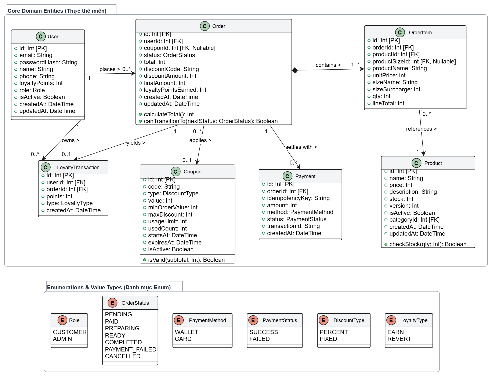
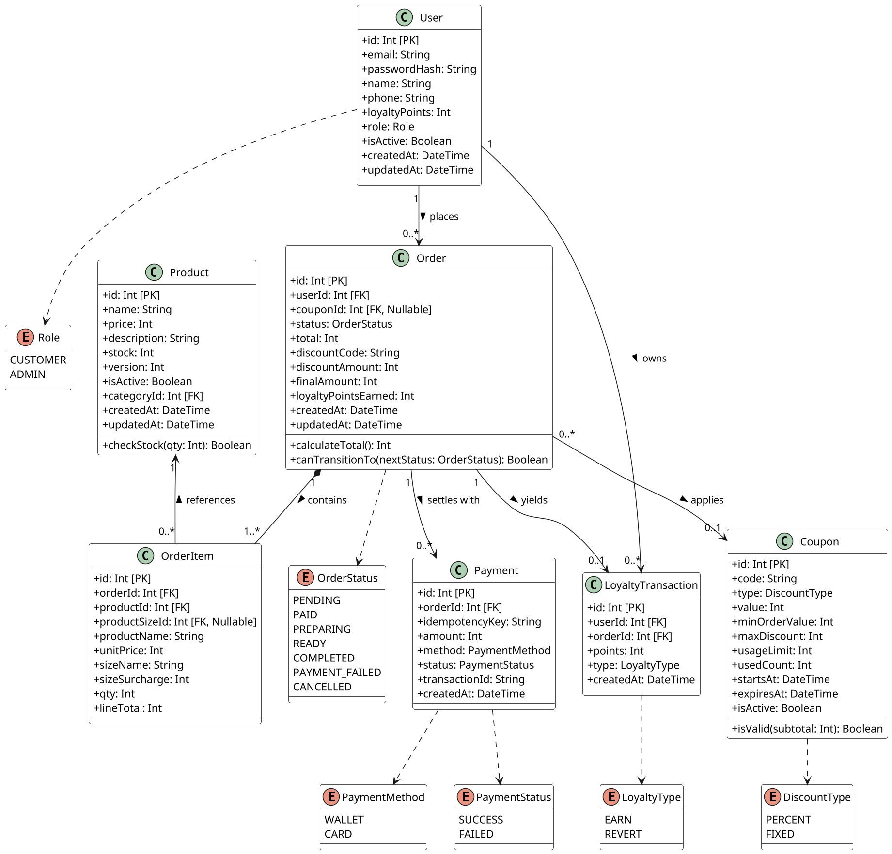

# Thiết kế Sơ đồ Lớp Hệ thống (Class Diagram) – BrewLite

> **Tệp tài liệu:** `docs/architecture/class-diagram.md`  
> **Tạo phẩm liên quan:** `docs/diagrams/design-class-diagram.puml`, `docs/diagrams/design-class-diagram.png`  
> **Giai đoạn:** Task 2 – Mô hình hóa hệ thống (Mục 4.3 Assignment 2)  
> **Phiên bản:** 1.1 (Đồng bộ với Prisma Schema & PostgreSQL) | Phạm vi: MVP

---

## 1. Mục tiêu và phạm vi thiết kế

Tài liệu này đặc tả cấu trúc dữ liệu và mô hình lớp ở mức miền (Domain Class Diagram) cho hệ thống BrewLite, làm nền tảng trực tiếp cho:
1. **Yêu cầu nghiệp vụ (Task 1):** Khớp với 8 nhóm yêu cầu chức năng `FR-01` – `FR-08` và các tiêu chí chất lượng `NFR-02`, `NFR-05` trong `srs.md`.
2. **Sơ đồ hành vi (Task 2):** Đồng bộ tên thuộc tính, phương thức và enum với Activity Diagram (`activity-checkout`) và Sequence Diagram (`sequence-checkout`).
3. **Hiện thực kỹ thuật (Task 3 & 4):** Ánh xạ trực tiếp 1-1 sang cơ sở dữ liệu PostgreSQL thông qua lược đồ Prisma ORM (`apps/api/prisma/schema.prisma`).

---

## 2. Sơ đồ lớp mức miền (Domain Class Diagram)

---

## 3. Đặc tả chi tiết các lớp thực thể (Entities)

Theo yêu cầu mục 4.3 trong quy cách đề bài, mô hình bao quát đầy đủ 7 lớp thực thể miền trọng tâm:

### 3.1. User (Người dùng)
* **Mục đích:** Lưu trữ thông tin tài khoản, danh tính, số dư điểm tích lũy và phân quyền người dùng.
* **Thuộc tính chính:**
  * `id: Int [PK]`: Khóa chính định danh tự tăng.
  * `email: String`: Địa chỉ email duy nhất dùng để đăng nhập.
  * `passwordHash: String`: Mật khẩu đã băm bằng thuật toán bcrypt.
  * `name: String`: Họ tên hiển thị của người dùng.
  * `phone: String`: Số điện thoại nhận hàng (duy nhất).
  * `loyaltyPoints: Int`: Tổng điểm tích lũy hiện tại của khách hàng.
  * `role: Role`: Phân quyền người dùng (`CUSTOMER` hoặc `ADMIN`).
  * `isActive: Boolean`: Trạng thái tài khoản (đang hoạt động hoặc bị khóa).

### 3.2. Product (Sản phẩm đồ uống)
* **Mục đích:** Quản lý thông tin đồ uống, giá niêm yết cơ bản và kiểm soát lượng hàng tồn kho.
* **Thuộc tính chính:**
  * `id: Int [PK]`: Khóa chính món đồ uống.
  * `name: String`: Tên hiển thị trên menu (ví dụ: "Trà sữa Ô Long").
  * `price: Int`: Đơn giá gốc (tính theo VNĐ, size chuẩn, chưa kèm topping).
  * `stock: Int`: Số lượng phần còn lại có thể bán trong ngày.
  * `version: Int`: Trường đánh dấu phiên bản dữ liệu phục vụ **Cơ chế khóa lạc quan (Optimistic Locking)** nhằm ngăn ngừa lỗi bán âm khi nhiều khách đặt cùng thời điểm (`NFR-05`).
  * `isActive: Boolean`: Trạng thái kinh doanh sản phẩm.
* **Phương thức:**
  * `checkStock(qty: Int): Boolean`: Kiểm tra tồn kho có đủ đáp ứng số lượng yêu cầu.

### 3.3. Order (Đơn hàng)
* **Mục đích:** Quản lý toàn bộ tiến trình đặt món, giá trị thanh toán và trạng thái xử lý đơn.
* **Thuộc tính chính:**
  * `id: Int [PK]`: Khóa chính đơn hàng.
  * `userId: Int [FK]`: Khóa ngoại tham chiếu người đặt hàng (`User`).
  * `couponId: Int [FK, Nullable]`: Khóa ngoại liên kết mã giảm giá áp dụng (nếu có).
  * `status: OrderStatus`: Trạng thái hiện tại của đơn hàng theo State Machine.
  * `total: Int`: Tổng tiền gốc của các món trước giảm giá.
  * `discountCode: String`: Mã giảm giá đã áp dụng tại thời điểm đặt đơn.
  * `discountAmount: Int`: Số tiền được chiết khấu giảm trừ.
  * `finalAmount: Int`: Số tiền thực tế khách cần chi trả (`total - discountAmount`).
  * `loyaltyPointsEarned: Int`: Số điểm thưởng nhận được từ đơn hàng (10.000đ = 1 điểm).
* **Phương thức:**
  * `calculateTotal(): Int`: Tính toán tổng tiền đơn hàng.
  * `canTransitionTo(nextStatus: OrderStatus): Boolean`: Xác thực tính hợp lệ của việc chuyển đổi trạng thái tiếp theo theo State Machine.

### 3.4. OrderItem (Chi tiết món trong đơn)
* **Mục đích:** Lưu trữ bản chụp (Snapshot) thông tin từng món tại thời điểm chốt đơn, bảo toàn dữ liệu lịch sử giá.
* **Thuộc tính chính:**
  * `id: Int [PK]`: Khóa chính dòng chi tiết.
  * `orderId: Int [FK]`: Khóa ngoại liên kết với `Order`.
  * `productId: Int [FK]`: Khóa ngoại trỏ đến món đồ uống gốc.
  * `productName: String`: Tên món chụp lại tại thời điểm đặt.
  * `unitPrice: Int`: Đơn giá món chụp lại tại thời điểm đặt.
  * `sizeName: String`: Tên kích thước đã chọn (M, L).
  * `sizeSurcharge: Int`: Phụ thu kích thước tại thời điểm đặt.
  * `qty: Int`: Số lượng ly đặt.
  * `lineTotal: Int`: Thành tiền của dòng chi tiết.

### 3.5. Payment (Giao dịch thanh toán)
* **Mục đích:** Lưu trữ nhật ký giao dịch thanh toán tài chính qua cổng thanh toán mô phỏng.
* **Thuộc tính chính:**
  * `id: Int [PK]`: Khóa chính giao dịch.
  * `orderId: Int [FK]`: Khóa ngoại tham chiếu đơn hàng cần thanh toán.
  * `idempotencyKey: String`: Khóa chống trùng lặp duy nhất (Unique Index), chặn trừ tiền hai lần khi client gửi lại request (`AC-06.7`, `NFR-05`).
  * `amount: Int`: Số tiền thực tế thực hiện giao dịch (VNĐ).
  * `method: PaymentMethod`: Phương thức (`WALLET` hoặc `CARD`).
  * `status: PaymentStatus`: Trạng thái giao dịch (`SUCCESS` hoặc `FAILED`).
  * `transactionId: String`: Mã tham chiếu giao dịch từ dịch vụ thanh toán.

### 3.6. Coupon (Mã giảm giá / Promotion)
* **Mục đích:** Quản lý chính sách khuyến mãi và giới hạn lượt sử dụng mã ưu đãi.
* **Thuộc tính chính:**
  * `id: Int [PK]`: Khóa chính mã giảm giá.
  * `code: String`: Mã nhập ưu đãi (duy nhất, ví dụ: `BREWNEW`).
  * `type: DiscountType`: Hình thức giảm (`PERCENT` hoặc `FIXED`).
  * `value: Int`: Mức giảm (% hoặc số tiền VNĐ cố định).
  * `minOrderValue: Int`: Giá trị đơn hàng tối thiểu để áp dụng mã.
  * `maxDiscount: Int`: Mức giảm tối đa áp dụng cho loại giảm theo %.
  * `usageLimit: Int`: Giới hạn tổng số lượt sử dụng toàn hệ thống.
  * `usedCount: Int`: Số lượt đã sử dụng thực tế.
  * `startsAt: DateTime`: Ngày bắt đầu hiệu lực.
  * `expiresAt: DateTime`: Ngày hết hạn ưu đãi.
  * `isActive: Boolean`: Cờ kích hoạt mã.
* **Phương thức:**
  * `isValid(subtotal: Int): Boolean`: Kiểm tra tính hợp lệ về thời gian, lượt dùng và giá trị đơn hàng.

### 3.7. LoyaltyTransaction (Lịch sử tích điểm)
* **Mục đích:** Theo dõi biến động cộng và hoàn trả điểm thưởng của khách hàng theo yêu cầu mục 4.3 trong PDF.
* **Thuộc tính chính:**
  * `id: Int [PK]`: Khóa chính giao dịch điểm.
  * `userId: Int [FK]`: Khóa ngoại tham chiếu khách hàng.
  * `orderId: Int [FK]`: Khóa ngoại tham chiếu đơn hàng phát sinh điểm.
  * `points: Int`: Số điểm biến động.
  * `type: LoyaltyType`: Phân loại biến động (`EARN`: cộng điểm khi thanh toán thành công; `REVERT`: thu hồi điểm khi đơn bị hủy - `AC-08.8`).

---

## 4. Các kiểu dữ liệu liệt kê (Enums)

| Tên Enum | Danh sách giá trị | Mục đích nghiệp vụ |
|---|---|---|
| `Role` | `CUSTOMER`, `ADMIN` | Phân quyền vai trò người dùng và bảo vệ API Endpoints. |
| `OrderStatus` | `PENDING`, `PAID`, `PREPARING`, `READY`, `COMPLETED`, `PAYMENT_FAILED`, `CANCELLED` | Kiểm soát vòng đời đơn hàng theo đúng State Machine. |
| `PaymentMethod` | `WALLET`, `CARD` | Hai phương thức thanh toán mô phỏng được hỗ trợ. |
| `PaymentStatus` | `SUCCESS`, `FAILED` | Kết quả xử lý thanh toán từ cổng mô phỏng. |
| `DiscountType` | `PERCENT`, `FIXED` | Hình thức chiết khấu của phiếu giảm giá. |
| `LoyaltyType` | `EARN`, `REVERT` | Phân loại biến động cộng hoặc trừ điểm thưởng. |

---

## 5. Đặc tả quan hệ và chỉ số bội số (Multiplicity)

1. **`User` $\longleftrightarrow$ `Order` ($1 : 0..*$):**  
   Một khách hàng có thể có 0 hoặc nhiều đơn hàng. Mỗi đơn hàng bắt buộc phải thuộc về đúng 1 người dùng đã đăng ký.
2. **`Order` $\longleftrightarrow$ `OrderItem` ($1 : 1..*$, Quan hệ Composition):**  
   Một đơn hàng bắt buộc phải có ít nhất 1 món chi tiết. Khi xóa `Order`, các `OrderItem` phụ thuộc sẽ bị xóa theo (Cascade Delete).
3. **`Product` $\longleftrightarrow$ `OrderItem` ($1 : 0..*$):**  
   Một món đồ uống có thể xuất hiện trong nhiều đơn hàng hoặc chưa từng được đặt.
4. **`Order` $\longleftrightarrow$ `Payment` ($1 : 0..*$):**  
   Một đơn hàng có thể có nhiều lượt thanh toán (lưu lại các lần thất bại trước khi thanh toán lại thành công).
5. **`Order` $\longleftrightarrow$ `Coupon` ($0..* : 0..1$):**  
   Mỗi đơn hàng chỉ được áp dụng tối đa 1 mã giảm giá. Một mã giảm giá có thể dùng cho nhiều đơn hàng khác nhau.
6. **`User` $\longleftrightarrow$ `LoyaltyTransaction` ($1 : 0..*$):**  
   Một người dùng sở hữu lịch sử gồm nhiều lần tích lũy hoặc điều chỉnh điểm thưởng.

> **Quy tắc biên miền (Domain Boundary Rule):**  
> Lớp `User` **không nối trực tiếp tới `Payment`**. Mọi giao dịch thanh toán đều là nghĩa vụ tài chính gắn với một đơn hàng cụ thể (`Order`). Do đó, `Payment` liên kết trực tiếp với `Order`, loại bỏ hoàn toàn liên kết vòng dư thừa (Redundant Association).

---

## 6. Tính nhất quán và khả năng truy vết (Traceability)

* **Khớp mô hình dữ liệu (Prisma Schema):** Tên trường, quan hệ và kiểu dữ liệu `Int` (VNĐ) đồng bộ 100% với tệp `schema.prisma`.
* **Khớp Sơ đồ tuần tự (Sequence Diagram):** Các trường `version` (khóa lạc quan), `idempotencyKey` (chống thanh toán trùng) và `OrderStatus` được sử dụng chính xác trong các kịch bản kiểm thử API Checkout và Payment.
* **Thỏa mãn tiêu chuẩn nghiệm thu Task 2.3:** Đảm bảo đầy đủ 7 thực thể miền theo đúng quy định trang 4 trong hồ sơ Assignment 2.