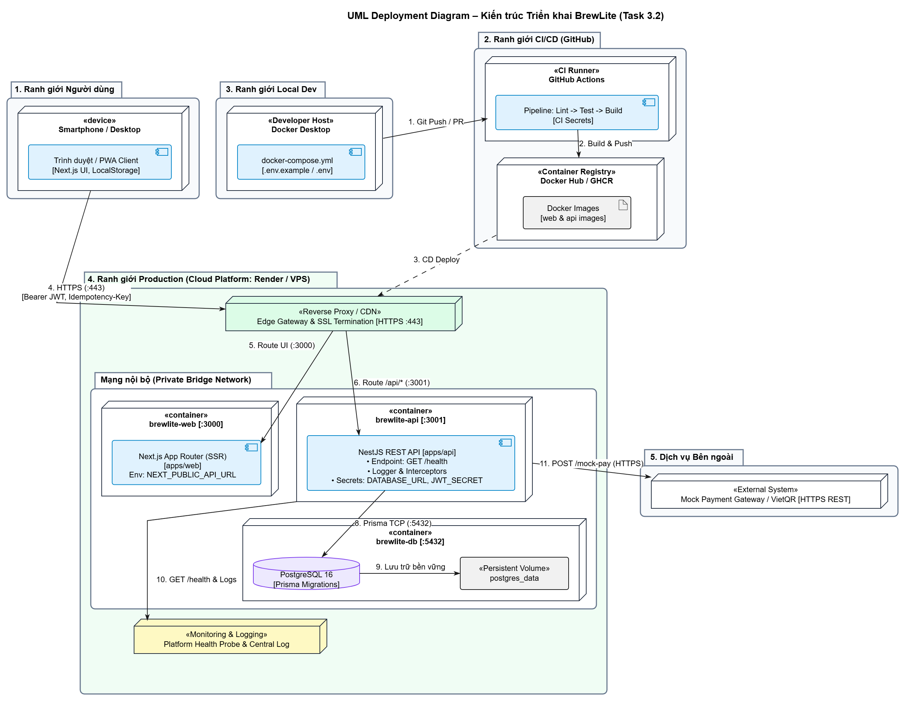

# BrewLite – Kiến trúc Triển khai, Bảo mật và Vận hành

| Mục | Nội dung |
|---|---|
| Phạm vi | Task 3.2: kiến trúc triển khai, truy vết node về mã nguồn, nạp biến môi trường/secret, giám sát và rollback |
| Phiên bản | 1.0 |
| Nguồn sơ đồ (PlantUML) | [`../diagrams/deployment-diagram.puml`](../diagrams/deployment-diagram.puml) |
| Ảnh kết xuất | `../diagrams/deployment-diagram.png` |
| Tài liệu liên quan | [`c4-model.md`](c4-model.md) (mục 2, 4) |

---

## 1. Mục đích và phạm vi

Tài liệu mô tả BrewLite được **đóng gói, triển khai, cấu hình, giám sát và khôi phục** như thế nào ở ba môi trường: Local, CI/CD và Production. Tài liệu kế thừa C2 trong `c4-model.md` (ba container Frontend, Backend, Database) và bổ sung lớp hạ tầng: reverse proxy, registry, pipeline, secret store, giám sát.

Ngoài phạm vi: autoscaling, nhiều bản sao Backend, dashboard/cảnh báo, sao lưu và khôi phục thảm hoạ.

## 2. Sơ đồ triển khai



Sơ đồ chia thành 5 ranh giới:

| Ranh giới | Nội dung | Ý nghĩa bảo mật |
|---|---|---|
| 1. Người dùng | Trình duyệt / PWA trên điện thoại hoặc máy tính | Không tin cậy; mọi dữ liệu vào đều được validate ở Backend |
| 2. CI/CD (GitHub) | GitHub Actions, Container Registry | Giữ CI Secret và token đẩy image; không giữ dữ liệu người dùng |
| 3. Local Dev | Docker Desktop chạy `docker-compose.yml` | Dữ liệu giả lập, secret chỉ có tác dụng trên máy dev |
| 4. Production | Edge Gateway, mạng nội bộ (web, api, db), giám sát | Chỉ Edge Gateway mở ra Internet (HTTPS 443) |
| – (trong 4) | Mạng nội bộ (Private Bridge Network) | `brewlite-web`, `brewlite-api`, `brewlite-db` không có cổng công khai |
| 5. Dịch vụ bên ngoài | Mock Payment Gateway (HTTPS REST) | Hệ thống ngoài về mặt logic; API gọi sang kèm `Idempotency-Key` |

Ghi chú khi đọc sơ đồ:

1. **Mock Payment**  là hệ thống ngoài, đúng với góc nhìn logic của C1/C2. Khi hiện thực MVP, nó chạy như module `mock-payment` trong `apps/api` (cùng tiến trình).
2. **Database** là container `brewlite-db` kèm volume `postgres_data`, đúng với Local và VPS. Nếu dùng Render, có thể dùng PostgreSQL do nền tảng quản lý; dù theo cách nào cũng **không mở cổng 5432 ra Internet**.
3. **Liên kết 10 (giám sát)** biểu diễn quan hệ giữa API và hệ thống giám sát. Cơ chế vận hành: nền tảng chủ động gọi `GET /health` vào API, còn API ghi log JSON ra stdout để nền tảng thu thập (mục 7).

## 3. Thuyết minh các node

| Node | Stereotype | Công nghệ | Cổng | Vai trò |
|---|---|---|---|---|
| Smartphone / Desktop | `<<device>>` | Trình duyệt, PWA | – | Hiển thị UI, giữ giỏ hàng và JWT (`localStorage`) |
| Edge Gateway | `<<Reverse Proxy / CDN>>` | Do nền tảng cung cấp | 443 | Kết thúc TLS, định tuyến UI về web và API về api |
| `brewlite-web` | `<<container>>` | Next.js (App Router, SSR) | 3000 | Render menu phía server; gọi API qua `API_INTERNAL_URL` |
| `brewlite-api` | `<<container>>` | NestJS (modular monolith) | 3001 | Nghiệp vụ, xác thực JWT, health check, log JSON |
| `brewlite-db` | `<<container>>` | PostgreSQL 16, Prisma | 5432 | Lưu dữ liệu; chỉ API truy cập |
| `postgres_data` | `<<Persistent Volume>>` | Docker volume | – | Dữ liệu còn nguyên khi container khởi động lại |
| GitHub Actions | `<<CI Runner>>` | Workflow Lint → Test → Build | – | Kiểm tra, build image, triển khai |
| Container Registry | `<<Container Registry>>` | Docker Hub hoặc GHCR | – | Lưu image `web` và `api`, gắn tag theo commit SHA |
| Platform Health Probe & Log | `<<Monitoring & Logging>>` | Do nền tảng cung cấp | – | Gọi `GET /health`, thu thập log stdout |
| Mock Payment Gateway | `<<External System>>` | HTTPS REST, JSON | – | Mô phỏng thanh toán Ví/Thẻ, nhận `Idempotency-Key` |

Tài liệu này mô tả kiến trúc triển khai áp dụng chung cho cả hai nền tảng (Render và VPS).

## 4. Bảng ánh xạ truy vết Node/Container về mã nguồn

| Node / Container | Mã nguồn | Artifact | Biến môi trường |
|---|---|---|---|
| Developer Host (Docker Desktop) | [`docker-compose.yml`](../../docker-compose.yml), [`.env.example`](../../.env.example) | Ba service `web`, `api`, `db` | Toàn bộ biến ở mục 6.2 |
| GitHub Actions pipeline | `.github/workflows/*.yml` | Workflow CI, CD | CI Secret (mục 6.3) |
| Container Registry / Docker Images | `apps/web/Dockerfile`, `apps/api/Dockerfile` | Image `brewlite-web`, `brewlite-api` | `NEXT_PUBLIC_API_URL` truyền lúc build cho web |
| Trình duyệt / PWA Client | [`apps/web`](../../apps/web) (manifest, service worker, trang App Router) | Bundle tĩnh, nằm trong image web | `NEXT_PUBLIC_API_URL` |
| `brewlite-web` | [`apps/web`](../../apps/web) | Image web | `NODE_ENV`, `NEXT_PUBLIC_API_URL`, `API_INTERNAL_URL` |
| `brewlite-api` | [`apps/api`](../../apps/api): `src/main.ts`, `src/health`, `src/common`, `src/payments` | Image api | `NODE_ENV`, `PORT`, `DATABASE_URL`, `JWT_SECRET`, `JWT_EXPIRES_IN`, `CORS_ORIGIN`, `LOG_LEVEL`, `PAYMENT_*` |
| Mock Payment Gateway | `apps/api/src/mock-payment` | Cùng image api | `PAYMENT_MOCK_ENABLED`, `PAYMENT_GATEWAY_URL`, `PAYMENT_TIMEOUT_MS` (và `WALLET_LIMIT`) |
| `brewlite-db` / PostgreSQL 16 | `docker-compose.yml` (service `db`); schema, migration, seed ở `apps/api/prisma` | Image `postgres:16` | `POSTGRES_USER`, `POSTGRES_PASSWORD`, `POSTGRES_DB` |
| Persistent Volume `postgres_data` | `docker-compose.yml` (khối `volumes`) | Docker volume | – |
| Edge Gateway | Không có mã nguồn; cấu hình trên nền tảng (TLS, route `/` và `/api/*`) | – | `CORS_ORIGIN` phải khớp domain công khai |
| Platform Health Probe & Log | Không có mã nguồn; cấu hình đường dẫn probe trên nền tảng; phía API: `src/health`, `src/common` | – | `LOG_LEVEL` |

Ánh xạ từng liên kết (số thứ tự theo sơ đồ):

| # | Liên kết | Giao thức | Cấu hình / mã liên quan |
|---|---|---|---|
| 1 | Local → CI | Git push, pull request | Nhánh `feat/*`, `develop`, `main` (README) |
| 2 | CI → Registry | Docker push | Workflow build; tag = commit SHA |
| 3 | Registry → Production (sơ đồ vẽ tới Edge Gateway) | CD deploy image `web`, `api`; trước đó chạy `prisma migrate deploy` | Workflow CD, secret triển khai |
| 4 | Người dùng → Edge | HTTPS 443, `Authorization: Bearer`, `Idempotency-Key` | TLS của nền tảng |
| 5 | Edge → web | HTTP nội bộ, cổng 3000 | Route `/` |
| 6 | Edge → api | HTTP nội bộ, cổng 3001 | Route `/api/*` |
| 7 | web → api (SSR) | HTTP nội bộ | `API_INTERNAL_URL` |
| 8 | api → db | Prisma qua TCP 5432 | `DATABASE_URL` |
| 9 | db → volume | Ghi đĩa | Khối `volumes` |
| 10 | api ↔ giám sát | Nền tảng gọi `GET /health`; API ghi log JSON ra stdout | `src/health`, `src/common` (logger), `LOG_LEVEL` |
| 11 | api → Mock Payment | HTTPS REST (`POST /mock-pay`) | `PAYMENT_GATEWAY_URL`, `PAYMENT_TIMEOUT_MS` |

## 5. Các môi trường triển khai

| Thuộc tính | Local | CI | Production |
|---|---|---|---|
| Chạy bằng | `docker compose up` | GitHub Actions runner | Nền tảng (Render hoặc VPS) |
| Ai dùng | Lập trình viên | Pipeline | Người dùng cuối, giảng viên chấm |
| Cổng mở ra ngoài | 3000, 3001, 5432 (chỉ máy dev) | Không | Chỉ 443 qua Edge Gateway |
| Database | Container + volume `postgres_data` | Service container tạm, bỏ sau mỗi lần chạy | PostgreSQL của nền tảng, hoặc container + volume trên VPS |
| Migration | `prisma migrate dev`, `prisma db seed` | `prisma migrate deploy` lên DB test | `prisma migrate deploy` trước khi bật bản mới |
| `LOG_LEVEL` | `debug` | `info` | `info` |
| Nguồn cấu hình | `.env` | GitHub Actions Secrets | Biến môi trường / secret của nền tảng |

Luồng thay đổi đi qua các môi trường:

```
Developer (feat/*) → Pull Request → [CI: Lint → Test → Build image]
        → merge vào develop → (tuỳ chọn: môi trường kiểm thử)
        → merge vào main → [CD: push image → migrate → deploy → smoke test] → Production
```

Quy ước: nhánh `main` là production (README); chỉ merge vào `main` mới kích hoạt CD.

## 6. Nạp biến môi trường, Secrets và bảo vệ dữ liệu

### 6.1 Nguyên tắc

1. Cấu hình theo 12-factor: **mọi giá trị khác nhau giữa các môi trường nằm trong biến môi trường**, không nằm trong mã nguồn hay image.
2. `@nestjs/config` nạp biến và **kiểm tra schema khi khởi động**. Thiếu hoặc sai biến bắt buộc thì API thoát với lỗi rõ ràng, nền tảng đánh dấu bản triển khai thất bại thay vì chạy với cấu hình sai (fail-fast).
3. `.env.example` chỉ chứa **tên biến và giá trị mẫu vô hại**; `.env`, `.env.local`, `.env.production` nằm trong `.gitignore`.
4. **Secret không được đóng vào image.** Image chỉ chứa mã; secret được truyền lúc chạy.
5. Biến `NEXT_PUBLIC_*` bị nhúng vào bundle lúc build và ai cũng đọc được, nên **không bao giờ chứa secret**. Vì vậy đổi `NEXT_PUBLIC_API_URL` phải build lại image web.

### 6.2 Danh mục biến và nơi nạp

| Biến | Thành phần | Loại | Local | CI | Production |
|---|---|---|---|---|---|
| `NODE_ENV` | API, Web | Cấu hình | `.env` | Workflow (`test`/`production` theo job) | Biến của nền tảng |
| `PORT` | API | Cấu hình | `.env` | – | Biến của nền tảng |
| `DATABASE_URL` | API | **Secret** | `.env` (trỏ `db:5432`) | Giá trị DB test tạm, tạo trong workflow | Secret của nền tảng |
| `JWT_SECRET` | API | **Secret** | `.env` (giá trị dev) | Giá trị ngẫu nhiên riêng cho test | Secret của nền tảng, tạo riêng cho production |
| `JWT_EXPIRES_IN` | API | Cấu hình | `.env` | – | Biến của nền tảng |
| `CORS_ORIGIN` | API | Cấu hình | `.env` (`http://localhost:3000`) | – | Domain công khai của web |
| `LOG_LEVEL` | API | Cấu hình | `debug` | `info` | `info` |
| `PAYMENT_GATEWAY_URL` | API | Cấu hình | `.env` (trỏ chính API) | Workflow | Biến của nền tảng |
| `PAYMENT_MOCK_ENABLED` | API | Cấu hình | `true` | `true` | `true` trong MVP |
| `PAYMENT_TIMEOUT_MS` | API | Cấu hình | `.env` | Workflow | Biến của nền tảng |
| `NEXT_PUBLIC_API_URL` | Web | Cấu hình, **công khai** | `.env` | Build argument | Build argument lúc build image |
| `API_INTERNAL_URL` | Web | Cấu hình | `.env` (`http://api:3001`) | – | Biến của nền tảng (địa chỉ nội bộ) |
| `POSTGRES_USER`, `POSTGRES_DB` | Database | Cấu hình | `.env` | Workflow | Do nền tảng cấp |
| `POSTGRES_PASSWORD` | Database | **Secret** | `.env` | Workflow | Do nền tảng cấp hoặc secret của VPS |

Mô tả chi tiết từng biến xem [`c4-model.md`](c4-model.md) mục 4.3.

### 6.3 Ba kênh nạp secret

| Kênh | Lưu ở đâu | Ai đọc được | Cách đi vào ứng dụng | Rủi ro và cách giảm |
|---|---|---|---|---|
| **Local `.env`** | File trên máy dev, không commit | Chính lập trình viên | `docker-compose.yml` đọc `.env` rồi truyền vào container (`env_file` hoặc `environment`) | Lỡ commit: đã có `.gitignore`; dùng giá trị dev, không dùng chung với production |
| **CI Secret** | GitHub Actions Secrets (cấp repository hoặc environment `production`) | Workflow được phép; giá trị bị che trong log | Workflow truyền qua `env:` hoặc `--build-arg` cho từng bước cần đến | Log lộ secret: GitHub tự che giá trị đã đăng ký, không `echo` biến; PR từ fork không nhận secret |
| **Production Env** | Kho secret / Environment Variables của nền tảng | Người có quyền quản trị dự án trên nền tảng | Nền tảng tiêm vào container lúc khởi động | Lộ khi chia sẻ quyền: chỉ cấp cho người cần; xoay vòng khi nghi ngờ |

Secret mà **pipeline CD** cần để triển khai (token đẩy image vào registry, khoá hoặc hook triển khai của nền tảng, `DATABASE_URL` để chạy migration) cũng lưu trong GitHub Actions Secrets của environment `production`. Tên cụ thể (ví dụ `REGISTRY_TOKEN`, `DEPLOY_HOOK_URL`) do nhóm đặt khi viết workflow.

Quy tắc vận hành secret:

- Giá trị production **khác hoàn toàn** giá trị local và CI; không dùng lại `JWT_SECRET`.
- Nghi ngờ lộ `JWT_SECRET`: đổi giá trị trên nền tảng rồi triển khai lại. Mọi token đang lưu hành mất hiệu lực, người dùng đăng nhập lại (hệ quả của việc không có refresh token).
- Nghi ngờ lộ `DATABASE_URL`: đổi mật khẩu người dùng DB trên nền tảng, cập nhật secret, triển khai lại.
- Không dán secret vào issue, pull request, ảnh chụp màn hình hay tài liệu.

### 6.4 Bảo vệ dữ liệu

| Lớp | Biện pháp |
|---|---|
| Trên đường truyền | HTTPS tại Edge Gateway (TLS); lưu lượng web, api, db còn lại đi trong mạng nội bộ; lời gọi sang Mock Payment dùng HTTPS |
| Truy cập dữ liệu | Chỉ `brewlite-api` kết nối DB; DB không mở cổng ra Internet; Frontend không truy cập DB |
| Mật khẩu | Băm bằng bcrypt, lưu ở `passwordHash`, không ghi log |
| Phiên đăng nhập | JWT ký bằng `JWT_SECRET`, thời hạn ngắn, kiểm tra `isActive`. Chi tiết xem [ADR-005](adr/005-jwt-authentication-rbac.md). |
| Thanh toán | Không nhận, không lưu số thẻ hoặc CVV; chỉ nhận token mô phỏng; số tiền lấy từ `Order.finalAmount` ở server |
| Nhật ký | Che `authorization`, mật khẩu, `passwordHash`, token thanh toán, `JWT_SECRET` |
| Toàn vẹn dữ liệu | Transaction khi tạo đơn và thanh toán; ràng buộc `idempotencyKey` duy nhất. Chi tiết xem [ADR-006](adr/006-optimistic-locking-stock.md) và [ADR-007](adr/007-idempotent-payment.md). |
| Lưu trữ bền | Volume `postgres_data` giữ dữ liệu khi container khởi động lại |
| Mã nguồn | Secret ngoài repo; `.gitignore` chặn `.env*` |

Rủi ro còn lại đã biết: JWT lưu ở `localStorage` có thể bị đánh cắp qua XSS; MVP chưa có quy trình sao lưu riêng.

## 7. Giám sát và ghi log

### 7.1 Health check

| Endpoint | Loại | Kiểm tra | Phản hồi | Dùng cho |
|---|---|---|---|---|
| `GET /health` | Liveness | Tiến trình còn phản hồi, **không** gọi DB | `200 {"status":"ok"}` | Health check của nền tảng (quyết định khởi động lại); `healthcheck` của service `api` trong compose |
| `GET /health/ready` | Readiness | Kết nối PostgreSQL (`SELECT 1`) | `200` khi sẵn sàng, `503` khi DB lỗi | Smoke test sau triển khai; chặn chuyển lưu lượng sang bản mới |

Lý do tách đôi: nếu `/health` kiểm tra cả DB, khi DB lỗi nền tảng sẽ khởi động lại API liên tục mà không giải quyết được gì. Hai endpoint đều công khai, không yêu cầu JWT, và không trả thông tin nhạy cảm (không có chuỗi kết nối, phiên bản chi tiết).

Mẫu `healthcheck` cho `docker-compose.yml` (mẫu tham khảo):

```yaml
services:
  db:
    image: postgres:16
    healthcheck:
      test: ["CMD-SHELL", "pg_isready -U $${POSTGRES_USER} -d $${POSTGRES_DB}"]
      interval: 5s
      timeout: 3s
      retries: 10
  api:
    depends_on:
      db:
        condition: service_healthy
    healthcheck:
      test: ["CMD-SHELL", "wget -qO- http://localhost:3001/health || exit 1"]
      interval: 10s
      timeout: 3s
      retries: 5
      start_period: 20s
```

### 7.2 Ghi log

| Nội dung | Giải pháp |
|---|---|
| Định dạng | JSON có cấu trúc, ghi ra stdout (ví dụ `nestjs-pino`); không ghi file trong container |
| Truy vết | `requestId` lấy từ header `x-request-id` hoặc tự sinh, trả lại trong response; web chuyển tiếp header này khi gọi API để nối log hai phía |
| Mức log | `LOG_LEVEL`: `debug` ở local, `info` ở production |
| Xem log | Local: `docker compose logs -f api`; Production: trình xem log của nền tảng |
| Sự kiện nghiệp vụ | Tạo đơn, kết quả thanh toán, xung đột tồn kho (409), đổi trạng thái đơn, lỗi 5xx |
| Che dữ liệu nhạy cảm | Không ghi `authorization`, mật khẩu, `passwordHash`, token thanh toán, `JWT_SECRET` |
| Tham chiếu | Chi tiết quyết định xem [ADR-010](adr/010-logging-health-config.md). |

Cách điều tra một sự cố: lấy `requestId` từ response lỗi hoặc từ report của người dùng, lọc log API theo `requestId` để xem toàn bộ chuỗi xử lý của request đó, kể cả lần gọi `mock-payment`.

Giới hạn: chưa có dashboard, cảnh báo tự động hay lưu log dài hạn; log mất khi nền tảng xoay vòng. Hiện tại việc phát hiện lỗi dựa vào health probe và việc đọc log thủ công.

## 8. Quy trình triển khai và kiểm soát rollback

### 8.1 Nguyên tắc

1. **Image bất biến, gắn tag theo commit SHA.** Không triển khai bằng tag `latest`, để luôn biết chính xác đang chạy bản nào và quay lại được bản nào.
2. **Migration tương thích ngược** (thêm trước, xoá sau). Nhờ đó rollback ứng dụng không cần rollback schema.
3. **Chỉ coi là thành công khi smoke test qua.** Bản triển khai chưa qua smoke test chưa được ghi nhận là "bản tốt gần nhất".
4. **Rollback ứng dụng là thao tác mặc định; rollback schema không làm tự động.**

### 8.2 Các bước triển khai (CD, khi merge vào `main`)

| Bước | Hành động | Điều kiện qua | Nếu thất bại |
|---|---|---|---|
| 1 | CI: Lint, Test (unit, integration), Build | Tất cả xanh | Dừng; không có gì được triển khai |
| 2 | Build và push image `web`, `api` với tag = commit SHA | Push thành công | Dừng; production không đổi |
| 3 | Ghi lại SHA của bản đang chạy (`PREV_SHA`) | Có giá trị | Dừng; không triển khai khi chưa biết bản để quay lại |
| 4 | `prisma migrate deploy` lên DB production | Migration áp dụng xong | Dừng, **không** bật bản mới; xử lý theo mục 8.4 |
| 5 | Triển khai image mới (api trước, web sau) | Nền tảng báo container chạy | Nền tảng giữ bản cũ nếu bản mới không qua health check; chuyển bước rollback |
| 6 | Smoke test: `GET /health` và `GET /health/ready` trên domain production | Cả hai trả `200` (thử lại mỗi 5 giây, tối đa 12 lần) | Rollback tự động (mục 8.3) |
| 7 | Kiểm tra nhanh luồng chính: `GET /products` trả `200` | Có dữ liệu menu | Rollback (mục 8.3) |
| 8 | Đánh dấu SHA mới là bản tốt gần nhất | – | – |

Các ngưỡng (5 giây, 12 lần, tức khoảng 60 giây) là giá trị đề xuất; chỉnh theo thời gian khởi động thực tế của API.

### 8.3 Rollback ứng dụng

Kích hoạt khi: smoke test bước 6 hoặc 7 thất bại; health check của nền tảng liên tục thất bại sau triển khai; hoặc tỉ lệ lỗi 5xx tăng đột biến trong log sau khi bản mới chạy.

| Bước | Hành động |
|---|---|
| 1 | Dừng đưa thêm thay đổi vào `main` cho đến khi xử lý xong |
| 2 | Triển khai lại image với tag `PREV_SHA` cho cả `api` và `web` (Render: chức năng Rollback / redeploy bản trước; VPS: `docker compose up -d` với tag cũ) |
| 3 | Chạy lại smoke test của bước 6, 7 trên bản đã quay lại |
| 4 | Xác nhận trong log: không còn lỗi 5xx liên tục, `requestId` mới xuất hiện bình thường |
| 5 | Ghi lại sự cố: SHA lỗi, thời điểm, triệu chứng, nguyên nhân sơ bộ; tạo issue sửa lỗi trên nhánh `feat/*` |

Vì migration luôn tương thích ngược, bản cũ chạy được trên schema mới. Nếu một migration **bắt buộc** phá vỡ tương thích (xoá cột, đổi kiểu), tách thành hai đợt phát hành: đợt đầu thêm cấu trúc mới và chuyển mã sang dùng nó; đợt sau, khi không còn bản cũ cần quay lại, mới xoá cấu trúc cũ.

### 8.4 Khi migration lỗi (bước 4)

`prisma migrate deploy` dừng và báo lỗi, bản mới **không** được bật nên người dùng vẫn dùng bản cũ trên schema hiện tại. Không có rollback tự động cho schema. Người phụ trách làm theo thứ tự:

1. Đọc log để biết migration nào lỗi và đã áp dụng được đến đâu.
2. Kiểm tra trạng thái thực tế của DB (bảng, cột đã tạo dở).
3. Sửa tay phần dở dang nếu cần, rồi dùng `prisma migrate resolve` để đánh dấu migration đúng trạng thái (`--applied` hoặc `--rolled-back`).
4. Sửa migration bằng một migration mới trên nhánh `feat/*`, không sửa migration đã áp dụng; sau đó chạy lại pipeline.

Chỉ khôi phục DB từ bản sao lưu khi dữ liệu đã bị hỏng; MVP chưa có quy trình sao lưu riêng nên đây là rủi ro cần đánh giá.

### 8.5 Bảng tình huống lỗi

| Tình huống | Phát hiện bởi | Hành động | Ảnh hưởng người dùng |
|---|---|---|---|
| CI đỏ | GitHub Actions | Sửa trên nhánh, không merge | Không |
| Thiếu biến bắt buộc | API thoát khi khởi động; health check không qua | Bổ sung biến trên nền tảng, triển khai lại; nếu cần, rollback | Không (bản cũ còn chạy) hoặc gián đoạn ngắn |
| Migration lỗi | Bước 4 | Mục 8.4 | Không |
| Bản mới chạy nhưng DB không kết nối được | `/health/ready` trả 503 | Kiểm tra `DATABASE_URL`, trạng thái DB; rollback nếu do bản mới | Có thể không đặt đơn được |
| Lỗi nghiệp vụ lộ ra sau khi smoke test qua | Log 5xx, báo cáo người dùng | Rollback theo mục 8.3 | Có, cho đến khi rollback xong |
| Cổng thanh toán quá thời gian (504) | Log, báo cáo | Không rollback: đây là hành vi thiết kế, đơn giữ `PENDING`, client gửi lại cùng `Idempotency-Key` | Khách thử lại |

## 9. Lịch sử thay đổi

| Phiên bản | Ngày | Nội dung / Lý do |
|---|---|---|
| 1.0 | 06/11/2026 | Khởi tạo: kiến trúc triển khai, truy vết node, nạp biến/secret, giám sát, rollback và phụ lục cấu hình. |

---

## Phụ lục A. Khung `.env.example` (chỉ tên biến, không giá trị thật)

```dotenv
# --- Chung ---
NODE_ENV=development

# --- API ---
PORT=3001
DATABASE_URL=postgresql://brewlite:change_me@db:5432/brewlite
JWT_SECRET=change_me_dev_only
JWT_EXPIRES_IN=15m
CORS_ORIGIN=http://localhost:3000
LOG_LEVEL=debug

# --- Thanh toán mô phỏng ---
PAYMENT_MOCK_ENABLED=true
PAYMENT_GATEWAY_URL=http://localhost:3001/mock-payment
PAYMENT_TIMEOUT_MS=5000

# --- Web ---
NEXT_PUBLIC_API_URL=http://localhost:3001
API_INTERNAL_URL=http://api:3001

# --- Database ---
POSTGRES_USER=brewlite
POSTGRES_PASSWORD=change_me
POSTGRES_DB=brewlite
```
