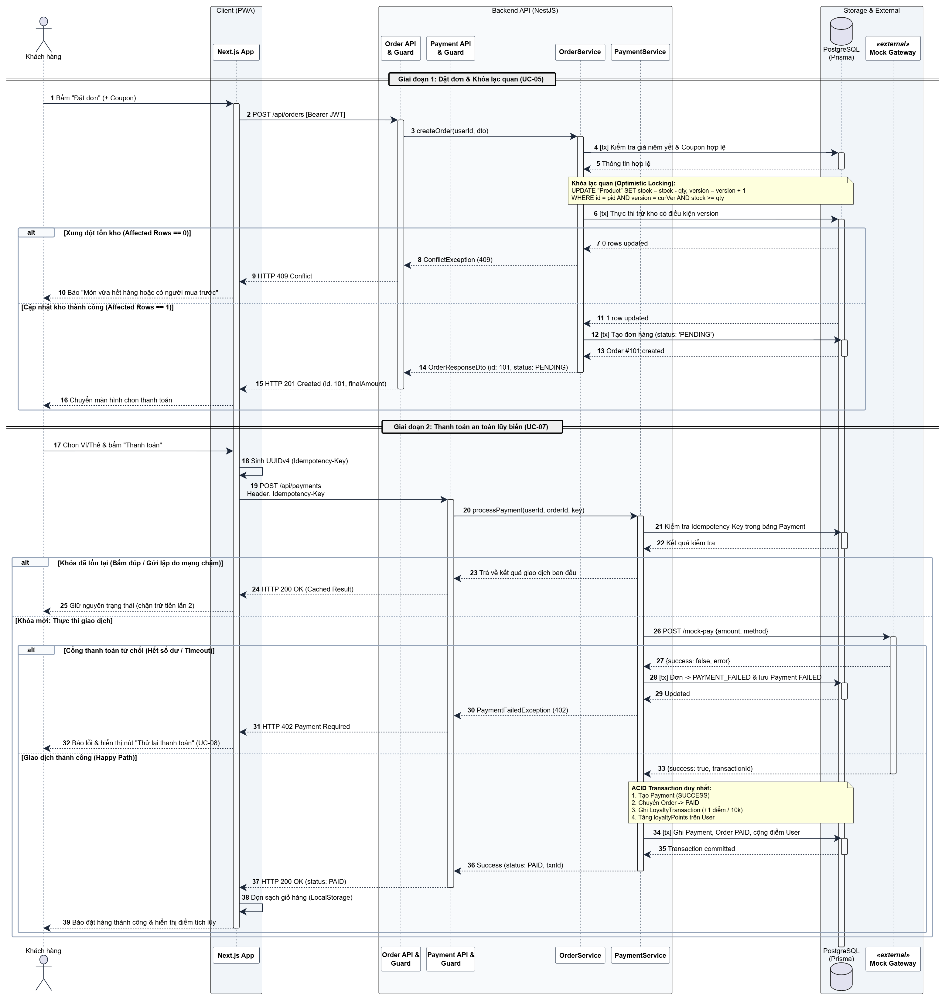
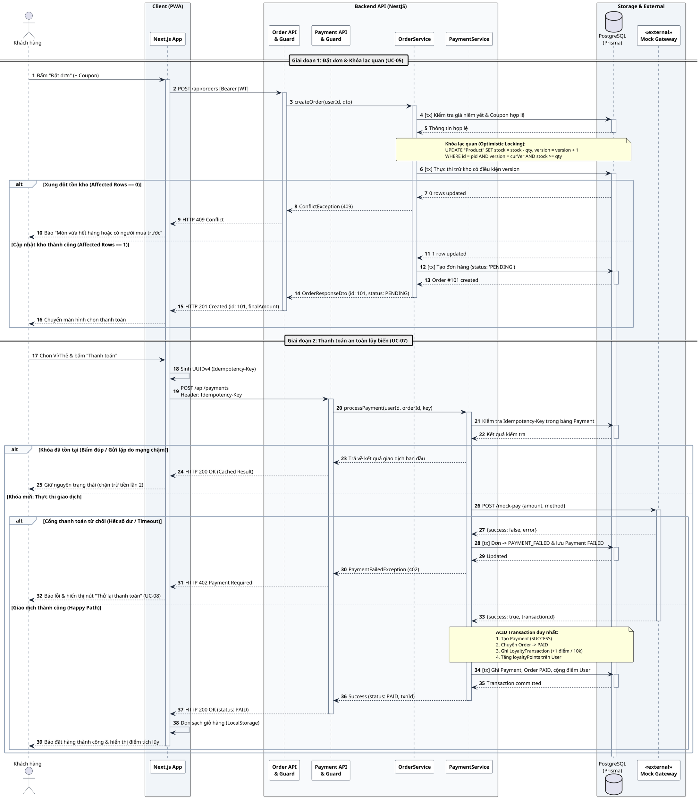

# Đặc tả Sơ đồ Tuần tự (Sequence Diagram) – Phân hệ Đặt hàng & Thanh toán BrewLite

> **Tệp tài liệu:** `docs/architecture/sequence-checkout.md`  
> **Tạo phẩm liên quan:** `docs/diagrams/sequence-checkout.puml`, `docs/diagrams/sequence-checkout.png`  
> **Nhiệm vụ:** Task 2.2 – Sơ đồ tuần tự (Assignment 2)  
> **Phạm vi use-case:** UC-05 (Đặt đơn hàng) & UC-07 (Thanh toán đơn hàng)[cite: 4, 5]  
> **Đồng bộ:** Khớp 100% với `srs.md`[cite: 5], `context-and-scope.md`[cite: 6], `usecase-checkout.md`[cite: 4] và `class-diagram.md`.

---

## 1. Mục tiêu và phạm vi đặc tả

Tài liệu này thuyết minh chi tiết tương tác động theo thời gian giữa các thành phần kiến trúc trong quy trình Checkout của BrewLite[cite: 4]. Sơ đồ tập trung giải quyết các bài toán kỹ thuật trọng yếu theo yêu cầu của đồ án:

1. **Kiểm soát đồng thời và tồn kho (Concurrency Control):** Ngăn ngừa tình trạng bán âm tồn kho khi nhiều khách hàng cùng đặt một món sắp hết hàng thông qua cơ chế **Khóa lạc quan (Optimistic Locking)** với trường `version` (`AC-05.13`, `NFR-05`)[cite: 4, 5, 6].
2. **Xử lý thanh toán an toàn lũy biến (Idempotency Enforcement):** Chặn việc trừ tiền và tạo giao dịch lặp khi người dùng bấm nút nhiều lần hoặc kết nối mạng chập chờn thông qua HTTP Header `Idempotency-Key` (`AC-06.7`, `NFR-05`)[cite: 4, 5, 6].
3. **Đảm bảo tính toàn vẹn trạng thái (ACID Transaction & State Machine):** Quản lý chu trình chuyển đổi trạng thái của đơn hàng (`PENDING` $\rightarrow$ `PAID` / `PAYMENT_FAILED`) cùng bản ghi tích điểm `LoyaltyTransaction` trong một giao dịch cơ sở dữ liệu duy nhất[cite: 4, 5].

---

## 2. Sơ đồ tuần tự tương tác (Sequence Diagram)





---

## 3. Các thành phần tham gia (Lifeline Participants)

| Tên Lifeline | Phân tầng kiến trúc | Công nghệ đảm nhiệm | Trách nhiệm chính trong kịch bản |
|---|---|---|---|
| **Khách hàng** | Actor | Người dùng cuối | Tương tác giao diện: đặt đơn, nhập mã giảm giá, chọn hình thức thanh toán và xác nhận giao dịch[cite: 4]. |
| **Next.js App** | Client Layer (PWA) | Next.js, React, Tailwind CSS | Quản lý giỏ hàng cục bộ, sinh khóa `Idempotency-Key` (UUIDv4), gửi HTTP requests kèm Bearer JWT và xử lý điều hướng màn hình[cite: 6]. |
| **Order API & Guard** | Presentation Layer | NestJS Controller, JWT AuthGuard | Xác thực danh tính người dùng (`userId`), kiểm tra tính hợp lệ của DTO đầu vào, điều hướng luồng xử lý xuống `OrderService`[cite: 4]. |
| **Payment API & Guard** | Presentation Layer | NestJS Controller, JWT AuthGuard | Trích xuất header `Idempotency-Key`, xác thực người dùng và ủy quyền xử lý giao dịch thanh toán cho `PaymentService`. |
| **OrderService** | Domain Service | NestJS Service, Prisma ORM | Tính toán tổng tiền từ giá niêm yết DB, thẩm định điều kiện áp dụng Coupon, thực thi giao dịch trừ kho với Khóa lạc quan[cite: 4]. |
| **PaymentService** | Domain Service | NestJS Service, Prisma ORM | Kiểm tra an toàn lũy biến, gọi Mock Gateway, điều phối cập nhật trạng thái đơn hàng và tích lũy điểm thưởng theo giao dịch ACID[cite: 4]. |
| **PostgreSQL (Prisma)** | Persistence Layer | PostgreSQL Database | Lưu trữ dữ liệu quan hệ, đảm bảo tính cô lập và toàn vẹn giao dịch (ACID transactions)[cite: 6]. |
| **Mock Gateway** | External Service | RESTful Mock Service | Giả lập cổng thanh toán Ví/Thẻ, phản hồi mã giao dịch thành công hoặc lỗi từ chối giao dịch[cite: 5]. |

---

## 4. Thuyết minh chi tiết luồng xử lý

### 4.1. Giai đoạn 1: Đặt đơn hàng & Khóa lạc quan (UC-05)

1. **Khởi tạo đặt đơn:** Khách hàng bấm nút "Xác nhận đặt đơn" trên giỏ hàng[cite: 4]. Giao diện Next.js thu thập các mục giỏ hàng kèm mã giảm giá (`couponCode` nếu có) và gửi `POST /api/orders` với Bearer JWT Token.
2. **Xác thực yêu cầu:** `Order API & Guard` kiểm tra tính hợp lệ của JWT. Nếu hợp lệ, trích xuất `userId` và gọi `OrderService.createOrder(userId, dto)`.
3. **Thẩm định giá niêm yết và Coupon:**
    - Hệ thống truy vấn trực tiếp bảng `Product` trong cơ sở dữ liệu để lấy đơn giá niêm yết, size, topping hiện hành, không dùng dữ liệu giá gửi từ phía client (`AC-05.2`)[cite: 4, 5].
    - Thẩm định mã giảm giá: kiểm tra hạn sử dụng, số lượt dùng còn lại (`usedCount < usageLimit`) và giá trị đơn hàng tối thiểu (`minOrderValue`) (`AC-05.8` $\rightarrow$ `AC-05.11`)[cite: 4, 5].
4. **Kiểm soát đồng thời bằng Khóa lạc quan (Optimistic Locking):**
    - Đọc giá trị `version` hiện hành của từng sản phẩm trong giỏ.
    - Thực thi lệnh cập nhật tồn kho có điều kiện phiên bản:
      ```sql
      UPDATE "Product"
      SET stock = stock - :qty, version = version + 1
      WHERE id = :productId AND version = :currentVersion AND stock >= :qty;
      ```
    - **Trường hợp xung đột (Conflict - Affected Rows == 0):** Do một khách hàng khác đã xác nhận mua trước làm tăng `version` hoặc tồn kho không đủ đáp ứng, lệnh update không tác động bản ghi nào[cite: 4]. `OrderService` ném `ConflictException (409)`. Client nhận mã `HTTP 409 Conflict` và hiển thị thông báo "Món vừa hết hàng hoặc có người mua trước" (`AC-05.13`, `NFR-05`)[cite: 4, 5].
    - **Trường hợp thành công (Affected Rows == 1):** Tồn kho được khấu trừ an toàn. Hệ thống tăng `usedCount` của Coupon (nếu có) và khởi tạo bản ghi `Order` ở trạng thái **`PENDING`** (`AC-05.1`)[cite: 4].
5. **Phản hồi:** Trả về `HTTP 201 Created` kèm `orderId` và `finalAmount`, client chuyển hướng khách hàng sang màn hình lựa chọn phương thức thanh toán.

---

### 4.2. Giai đoạn 2: Thanh toán an toàn lũy biến & Chuyển trạng thái (UC-07)

1. **Khởi tạo thanh toán & Sinh khóa Idempotency:**
    - Khách hàng chọn phương thức thanh toán (Ví hoặc Thẻ) và bấm "Xác nhận thanh toán"[cite: 4].
    - Client tự động sinh chuỗi định danh ngẫu nhiên `UUIDv4` gắn vào Header `Idempotency-Key` và gửi `POST /api/payments`.
2. **Kiểm tra an toàn lũy biến (Idempotency Check):**
    - `PaymentService` tra cứu khóa trong bảng `Payment` theo `idempotencyKey`.
    - **Trường hợp khóa đã tồn tại (Duplicate Request):** Xảy ra khi người dùng bấm đúp hoặc mạng chậm khiến request gửi lặp[cite: 5]. Hệ thống lập tức trả về kết quả giao dịch đã lưu trước đó kèm mã `HTTP 200 OK (Cached Result)`, chặn hoàn toàn việc trừ tiền lần hai (`AC-06.7`, `NFR-05`)[cite: 5].
    - **Trường hợp khóa mới:** Hệ thống xác thực đơn hàng thuộc quyền sở hữu của `userId` và trạng thái hiện tại phải là `PENDING` hoặc `PAYMENT_FAILED`[cite: 4]. Sau đó, chuyển tiếp yêu cầu sang `Mock Gateway`.
3. **Xử lý phản hồi từ Cổng thanh toán:**
    - **Nhánh từ chối / Lỗi mạng (Gateway Failed):** Nếu tài khoản không đủ số dư hoặc quá thời gian chờ, hệ thống tạo bản ghi `Payment` với trạng thái `FAILED`, cập nhật trạng thái đơn hàng thành `PAYMENT_FAILED`[cite: 4]. API trả về `HTTP 402 Payment Required`. Client hiển thị thông báo lỗi bằng tiếng Việt kèm nút "Thử lại thanh toán" để kích hoạt use-case UC-08 (`AC-06.5`, `AC-06.6`)[cite: 4, 5].
    - **Nhánh thanh toán thành công (Happy Path):** `Mock Gateway` phản hồi thành công kèm mã `transactionId`[cite: 4]. Hệ thống thực thi một giao dịch cơ sở dữ liệu duy nhất (`$transaction`) đảm bảo nguyên tử (Atomicity):
        1. Khởi tạo bản ghi `Payment` với trạng thái `SUCCESS` và lưu `idempotencyKey`.
        2. Cập nhật trạng thái `Order` từ `PENDING` sang **`PAID`** (`AC-06.1`)[cite: 4].
        3. Khởi tạo bản ghi `LoyaltyTransaction` loại `EARN` ghi nhận điểm tích lũy theo quy tắc 10.000đ được 1 điểm (`AC-06.2`)[cite: 4, 5].
        4. Tăng trường `loyaltyPoints` tương ứng trên bảng `User`.
4. **Hoàn tất chu trình:** `Payment API` phản hồi `HTTP 200 OK`. Client dọn sạch dữ liệu giỏ hàng trên trình duyệt (`LocalStorage`), hiển thị màn hình xác nhận đặt hàng thành công kèm điểm thưởng vừa tích lũy (`AC-06.3`)[cite: 4, 5].

---

## 5. Quy tắc chuyển trạng thái đơn hàng (State Machine Mapping)

```text
        (Khởi tạo UC-05)
               │
               ▼
           [ PENDING ] ◄────────────────────────┐
               │                                │
    (Thanh toán thành công)           (Khách bấm thử lại UC-08)
               │                                │
               ├──────────────────────┐         │
               ▼                      ▼         │
            [ PAID ]         [ PAYMENT_FAILED ] ┘
               │                      │
       (Admin tiếp nhận)       (Hết hạn chờ / Admin hủy)
               │                      │
               ▼                      ▼
         [ PREPARING ]          [ CANCELLED ]
```

- **Tính bất biến của đơn đã thanh toán:** Khi đơn đã đạt trạng thái `PAID`, mọi nỗ lực thanh toán lại với đơn này đều bị chặn (`AC-06.8`)[cite: 4, 5].
- **Cơ chế thanh toán lại (UC-08):** Đơn ở trạng thái `PAYMENT_FAILED` cho phép khách hàng tạo một yêu cầu thanh toán mới với `Idempotency-Key` mới từ trang "Đơn của tôi" (`AC-07.7`)[cite: 4, 5].

---

## 6. Ma trận truy vết yêu cầu (Traceability Matrix)

| Kịch bản trên Sequence Diagram | Bước thực thi | Mã Yêu cầu SRS | Tiêu chí chấp nhận (AC) | Kết quả kiểm chứng |
|---|:---:|---|---|---|
| Khóa lạc quan khi trừ tồn kho | Bước 6 → 10 | FR-05, NFR-05[cite: 4] | AC-05.13, AC-N05.2[cite: 4] | Trả về `HTTP 409 Conflict` khi xảy ra tranh chấp dữ liệu đồng thời. |
| Đặt đơn thành công | Bước 11 → 16 | FR-05[cite: 4] | AC-05.1, AC-05.3[cite: 4] | Đơn được tạo ở trạng thái `PENDING`, tồn kho bị trừ chính xác[cite: 4]. |
| Chống trùng thanh toán lũy biến | Bước 21 → 25 | FR-06, NFR-05[cite: 4] | AC-06.7, AC-N05.3[cite: 4] | Trả về kết quả giao dịch đã lưu, không gọi cổng thanh toán lần 2. |
| Thanh toán thất bại & Thử lại | Bước 26 → 32 | FR-06[cite: 4] | AC-06.5, AC-06.6, AC-07.7[cite: 4] | Đơn chuyển `PAYMENT_FAILED`, hiển thị lỗi tiếng Việt và cho phép thử lại[cite: 4]. |
| Thanh toán thành công & Tích điểm | Bước 33 → 39 | FR-06[cite: 4] | AC-06.1, AC-06.2, AC-06.3[cite: 4] | Đơn chuyển `PAID`, xóa giỏ hàng, điểm thưởng được cộng vào tài khoản[cite: 4]. |