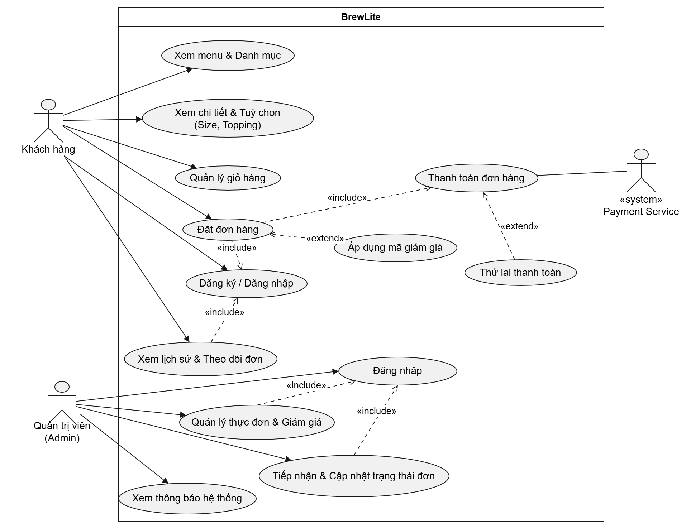
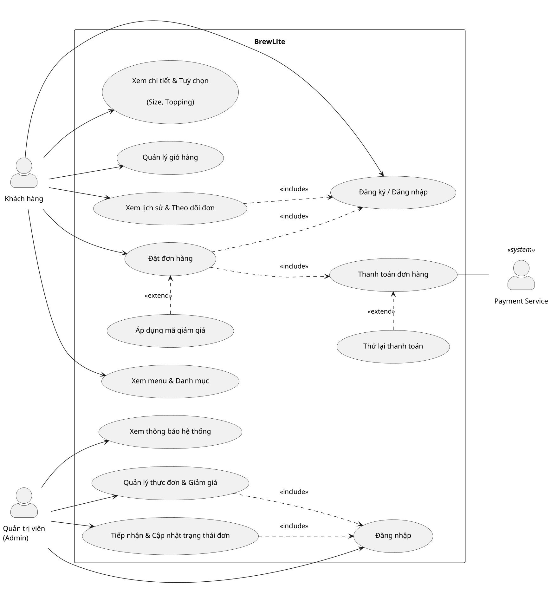

# Đặc tả yêu cầu phần mềm (SRS) – BrewLite

> Tệp: `docs/requirements/srs.md`
> Phiên bản: 1.0 (bản đầu tiên) | Phạm vi: MVP

## 1. Giới thiệu

### 1.1 Mục đích tài liệu

Tài liệu mô tả BrewLite cần làm gì từ góc nhìn nghiệp vụ: ai sử dụng, sử dụng để làm gì, quy trình diễn ra thế nào và khi nào một tính năng được xem là đạt yêu cầu. Tài liệu là cơ sở để nhóm phát triển, người kiểm thử và bên nghiệm thu cùng hiểu một nội dung.

### 1.2 Bối cảnh nghiệp vụ

BrewLite là hệ thống đặt đồ uống trực tuyến cho một cửa hàng trà và cà phê. Khách hàng chọn đồ uống ngay trên điện thoại thay vì xếp hàng gọi tại quầy; cửa hàng nhận đơn đã được thanh toán và chuẩn bị theo thứ tự. Khách nhận đồ uống tại quầy, hệ thống không phục vụ giao hàng.

### 1.3 Quy trình nghiệp vụ tổng quát

`Xem menu → Chọn tùy chọn → Giỏ hàng → Đặt đơn → Thanh toán → Theo dõi đơn`

### 1.4 Người dùng

| Người dùng | Vai trò trong nghiệp vụ |
|---|---|
| Khách hàng | Xem thực đơn, chọn đồ uống, đặt đơn, thanh toán và theo dõi đơn của mình |
| Quản trị viên | Nhận và xử lý đơn, quản lý thực đơn và mã giảm giá, theo dõi hoạt động kinh doanh |
| Dịch vụ thanh toán | Bên xử lý giao dịch Ví/Thẻ và trả về kết quả thành công hoặc thất bại. Giai đoạn đầu dùng bản mô phỏng |

### 1.5 Quy ước trình bày

- **MoSCoW:** Must (bắt buộc phải có), Should (nên có), Could (có thể có nếu còn thời gian), Won't (không làm trong giai đoạn này).
- **Mã định danh:** FR-xx cho yêu cầu chức năng, NFR-xx cho yêu cầu phi chức năng, AC-xx.y cho tiêu chí chấp nhận thứ y của yêu cầu xx.
- **Tiêu chí chấp nhận (AC):** viết theo dạng Given (bối cảnh) – When (hành động) – Then (kết quả mong đợi) để có thể kiểm chứng bằng cách thực hiện lại kịch bản.

## 2. Bảng yêu cầu chức năng

| Mã | Tên tính năng | Mô tả ngắn | Người dùng | MoSCoW |
|---|---|---|---|---|
| FR-01 | Xem thực đơn | Xem danh sách đồ uống đang bán, tìm kiếm và lọc theo nhóm | Khách hàng | Must |
| FR-02 | Xem chi tiết và chọn tùy chọn | Xem chi tiết đồ uống, chọn size, topping và số lượng | Khách hàng | Must |
| FR-03 | Giỏ hàng | Gom các món đã chọn, chỉnh sửa và xem tổng tiền | Khách hàng | Must |
| FR-04 | Đăng ký và đăng nhập | Tạo tài khoản, đăng nhập, quản lý thông tin cá nhân | Khách hàng, Quản trị viên | Must |
| FR-05 | Đặt đơn | Chuyển giỏ hàng thành đơn, áp dụng mã giảm giá | Khách hàng | Must |
| FR-06 | Thanh toán | Thanh toán đơn bằng Ví hoặc Thẻ, tích điểm | Khách hàng | Must |
| FR-07 | Lịch sử và theo dõi đơn | Xem xác nhận, trạng thái và lịch sử đơn của mình | Khách hàng | Must |
| FR-08 | Quản lý đơn hàng | Xem danh sách đơn, cập nhật tiến độ, hủy đơn | Quản trị viên | Must |

## 3. Trạng thái đơn hàng

| Trạng thái | Ý nghĩa | Có thể chuyển sang |
|---|---|---|
| Chờ thanh toán | Đơn vừa được tạo, khách chưa thanh toán | Đã thanh toán, Thanh toán thất bại, Đã hủy |
| Thanh toán thất bại | Lần thanh toán gần nhất không thành công | Chờ thanh toán (để thử lại), Đã hủy |
| Đã thanh toán | Cửa hàng đã nhận tiền, chờ pha chế | Đang pha chế, Đã hủy |
| Đang pha chế | Cửa hàng đang chuẩn bị đồ uống | Sẵn sàng |
| Sẵn sàng | Đồ uống đã xong, chờ khách nhận | Hoàn tất |
| Hoàn tất | Khách đã nhận đồ uống | Không chuyển tiếp |
| Đã hủy | Đơn bị hủy | Không chuyển tiếp |

Luồng bình thường: Chờ thanh toán → Đã thanh toán → Đang pha chế → Sẵn sàng → Hoàn tất.

## 4. Đặc tả chức năng

### FR-01 – Xem thực đơn

**Mô tả.** Giúp khách hàng nhanh chóng biết cửa hàng đang bán gì, giá bao nhiêu và món nào còn hàng. Người dùng: khách hàng, kể cả khi chưa đăng nhập.

**Các bước thực hiện**
1. Khách mở trang thực đơn.
2. Khách xem danh sách đồ uống kèm hình ảnh, tên và giá.
3. Khách chọn một nhóm đồ uống (ví dụ trà sữa, cà phê, trà trái cây) hoặc nhập từ khóa để tìm món.
4. Khách chọn một món để xem chi tiết.

**Tiêu chí chấp nhận**
- AC-01.1: Given cửa hàng có đồ uống đang bán, When khách mở trang thực đơn, Then khách thấy danh sách đồ uống, mỗi món có hình ảnh, tên và giá.
- AC-01.2: Given một đồ uống đã được cửa hàng ngừng bán, When khách xem thực đơn, Then đồ uống đó không xuất hiện.
- AC-01.3: Given khách chọn một nhóm đồ uống, When danh sách được cập nhật, Then chỉ các món thuộc nhóm đó được hiển thị.
- AC-01.4: Given khách nhập một phần tên món (có dấu hoặc không dấu), When tìm kiếm, Then danh sách chỉ còn các món có tên phù hợp.
- AC-01.5: Given không có món nào khớp với nhóm hoặc từ khóa đã chọn, When xem kết quả, Then khách thấy thông báo không có đồ uống phù hợp và gợi ý đổi nhóm hoặc từ khóa.
- AC-01.6: Given dữ liệu thực đơn đang được tải, When khách chờ, Then khách thấy dấu hiệu đang tải thay vì màn hình trống.
- AC-01.7: Given không tải được thực đơn, When màn hình hiển thị, Then khách thấy thông báo lỗi và nút "Tải lại"; khi bấm nút, hệ thống thử tải lại thực đơn.
- AC-01.8: Given một món đã hết hàng, When khách xem thực đơn, Then món đó được gắn nhãn "Hết hàng" và khách không thể thêm món vào giỏ.

### FR-02 – Xem chi tiết và chọn tùy chọn

**Mô tả.** Cho phép khách xem thông tin đầy đủ của đồ uống và tùy chỉnh theo khẩu vị trước khi thêm vào giỏ. Người dùng: khách hàng.

**Các bước thực hiện**
1. Khách mở trang chi tiết của một đồ uống.
2. Khách xem mô tả, giá và số lượng còn lại (nếu sắp hết).
3. Khách chọn size.
4. Khách chọn các topping phù hợp với món (nếu có).
5. Khách chọn số lượng.
6. Khách bấm "Thêm vào giỏ".

**Tiêu chí chấp nhận**
- AC-02.1: Given khách chọn một món đang bán, When mở trang chi tiết, Then khách thấy hình ảnh, tên, mô tả, giá và các size đang được phục vụ.
- AC-02.2: Given món thuộc nhóm có topping, When khách xem chi tiết, Then khách thấy danh sách topping đang phục vụ của nhóm đó và có thể chọn nhiều topping.
- AC-02.3: Given món thuộc nhóm không có topping (ví dụ cà phê), When khách xem chi tiết, Then khách không thấy lựa chọn topping.
- AC-02.4: Given món giá 40.000đ, size L phụ thu 6.000đ, một topping giá 5.000đ, When khách chọn size L và topping đó, Then giá một ly hiển thị là 51.000đ và tổng tiền thay đổi theo số lượng đã chọn.
- AC-02.5: Given món còn N phần, When khách chọn số lượng, Then khách chỉ chọn được từ 1 đến N phần.
- AC-02.6: Given món chỉ còn từ 1 đến 5 phần, When khách xem chi tiết, Then khách thấy thông báo "Chỉ còn X phần".
- AC-02.7: Given món đã hết hàng, When khách xem chi tiết, Then nút thêm vào giỏ không dùng được và có ghi "Hết hàng".
- AC-02.8: Given khách mở một món không tồn tại hoặc đã ngừng bán, When trang hiển thị, Then khách thấy thông báo không tìm thấy món.
- AC-02.9: Given khách chọn xong tùy chọn, When bấm "Thêm vào giỏ", Then khách nhận thông báo đã thêm và có lối đi nhanh tới giỏ hàng.

### FR-03 – Giỏ hàng

**Mô tả.** Giúp khách gom nhiều món, kiểm tra lại lựa chọn và biết tổng tiền trước khi đặt. Người dùng: khách hàng.

**Các bước thực hiện**
1. Khách mở giỏ hàng.
2. Khách kiểm tra từng dòng: tên món, size, topping, số lượng, thành tiền.
3. Khách tăng, giảm số lượng, đổi size hoặc topping, hoặc xóa món.
4. Khách xem tổng tiền.
5. Khách bấm "Thanh toán" để tiếp tục đặt đơn.

**Tiêu chí chấp nhận**
- AC-03.1: Given giỏ hàng trống, When khách thêm một món, Then giỏ hiển thị một dòng với tên món, size, topping, số lượng và thành tiền.
- AC-03.2: Given giỏ đã có một món, When khách thêm lại cùng món với cùng size và cùng topping, Then số lượng của dòng đó tăng lên thay vì tạo dòng mới.
- AC-03.3: Given giỏ có 2 ly giá 40.000đ và 1 ly giá 55.000đ, When khách xem giỏ, Then tổng tiền là 135.000đ.
- AC-03.4: Given giỏ có món, When khách tăng, giảm số lượng, đổi tùy chọn hoặc xóa món, Then thành tiền và tổng tiền được cập nhật ngay.
- AC-03.5: Given một dòng có số lượng 1, When khách bấm giảm, Then dòng đó bị xóa khỏi giỏ.
- AC-03.6: Given số lượng trong giỏ đã bằng số phần còn lại của món, When khách xem nút tăng, Then nút tăng không dùng được.
- AC-03.7: Given khách đã thêm món vào giỏ, When khách đóng rồi mở lại trang, Then các món vẫn còn trong giỏ.
- AC-03.8: Given giỏ hàng trống, When khách mở giỏ, Then khách thấy thông báo "Giỏ hàng trống" và nút quay về thực đơn.
- AC-03.9: Given khách chưa đăng nhập, When khách bấm "Thanh toán", Then hệ thống yêu cầu đăng nhập và sau khi đăng nhập đưa khách quay lại bước thanh toán.
- AC-03.10: Given giỏ đang chứa món của một khách, When một khách khác đăng nhập trên cùng thiết bị, Then khách mới không thấy món của khách trước.

### FR-04 – Đăng ký và đăng nhập

**Mô tả.** Xác định danh tính để đơn hàng, điểm tích lũy và lịch sử thuộc đúng người; đồng thời phân biệt khách hàng với quản trị viên. Người dùng: khách hàng, quản trị viên.

**Các bước thực hiện – đăng ký**
1. Khách chọn "Đăng ký".
2. Khách nhập email, mật khẩu và các thông tin cá nhân (họ tên, số điện thoại, giới tính – không bắt buộc).
3. Khách gửi đăng ký và nhận thông báo kết quả.
4. Khách đăng nhập bằng tài khoản vừa tạo.

**Các bước thực hiện – đăng nhập và quản lý tài khoản**
1. Người dùng nhập email và mật khẩu rồi chọn "Đăng nhập".
2. Hệ thống đưa người dùng vào đúng khu vực: khách hàng vào cửa hàng, quản trị viên vào khu quản trị.
3. Khi cần, người dùng xem hoặc sửa thông tin cá nhân và đổi mật khẩu.
4. Người dùng chọn "Đăng xuất" khi dùng xong.

**Tiêu chí chấp nhận**
- AC-04.1: Given email và số điện thoại chưa được dùng, mật khẩu hợp lệ, When khách đăng ký, Then tài khoản khách hàng được tạo và khách được báo đăng ký thành công.
- AC-04.2: Given mật khẩu ngắn hơn 8 ký tự hoặc thiếu chữ hoa, chữ thường, chữ số hoặc ký tự đặc biệt, When khách đăng ký, Then hệ thống từ chối và nêu rõ mật khẩu cần đáp ứng điều kiện nào.
- AC-04.3: Given email hoặc số điện thoại không đúng định dạng, When khách đăng ký, Then hệ thống từ chối và báo trường nào chưa hợp lệ.
- AC-04.4: Given email hoặc số điện thoại đã có tài khoản, When khách đăng ký, Then hệ thống báo thông tin đã được sử dụng và không tạo tài khoản mới.
- AC-04.5: Given tài khoản hợp lệ, When người dùng nhập đúng email và mật khẩu, Then người dùng được đăng nhập và thấy tên của mình trên màn hình.
- AC-04.6: Given email hoặc mật khẩu sai, When người dùng đăng nhập, Then hệ thống báo "tài khoản hoặc mật khẩu không chính xác" mà không cho biết cái nào sai.
- AC-04.7: Given tài khoản đã bị quản trị viên khóa, When người dùng đăng nhập, Then hệ thống từ chối và hướng dẫn liên hệ quản trị viên.
- AC-04.8: Given người dùng đã đăng nhập hơn 24 giờ, When người dùng thực hiện thao tác cần đăng nhập, Then hệ thống yêu cầu đăng nhập lại.
- AC-04.9: Given người dùng chưa đăng nhập, When truy cập chức năng đặt đơn, thanh toán, xem đơn hoặc khu quản trị, Then hệ thống đưa người dùng tới trang đăng nhập.
- AC-04.10: Given khách hàng đã đăng nhập, When khách cố mở khu quản trị, Then hệ thống từ chối và không hiển thị dữ liệu quản trị.
- AC-04.11: Given khách đã đăng nhập, When khách xem và sửa thông tin cá nhân, Then chỉ thông tin của chính khách được hiển thị và cập nhật.
- AC-04.12: Given khách nhập sai mật khẩu hiện tại hoặc mật khẩu mới và phần xác nhận không trùng nhau, When đổi mật khẩu, Then hệ thống từ chối và mật khẩu cũ vẫn dùng được.
- AC-04.13: Given người dùng đã đăng xuất, When người dùng bấm quay lại hoặc mở lại trang cần đăng nhập, Then hệ thống yêu cầu đăng nhập lại.

### FR-05 – Đặt đơn

**Mô tả.** Chuyển các món trong giỏ thành một đơn hàng chính thức, giữ chỗ nguyên liệu cho khách và tính đúng số tiền cần trả, kể cả khi áp dụng mã giảm giá. Người dùng: khách hàng đã đăng nhập.

**Các bước thực hiện**
1. Khách kiểm tra lại các món và tổng tiền ở bước thanh toán.
2. Khách nhập mã giảm giá nếu có và xem số tiền được giảm.
3. Khách xác nhận đặt đơn.
4. Hệ thống tạo đơn ở trạng thái "Chờ thanh toán" và hiển thị mã đơn, tổng tiền, số tiền giảm, số tiền phải trả.
5. Khách chuyển sang bước thanh toán.

**Tiêu chí chấp nhận**
- AC-05.1: Given khách đã đăng nhập và các món trong giỏ đều còn hàng, When khách xác nhận đặt đơn, Then đơn được tạo ở trạng thái "Chờ thanh toán" với mã đơn, tổng tiền, tiền giảm và số tiền phải trả.
- AC-05.2: Given đơn được tạo, When hệ thống tính tiền, Then số tiền dựa trên giá niêm yết, phụ thu size và giá topping hiện hành của cửa hàng, không dựa trên số tiền khách nhìn thấy trước đó.
- AC-05.3: Given đơn được tạo thành công, When kiểm tra số lượng còn lại, Then số phần còn lại của mỗi món giảm đúng bằng số lượng khách đã đặt.
- AC-05.4: Given một món trong giỏ không còn đủ số lượng, When khách đặt đơn, Then hệ thống từ chối cả đơn, nêu rõ món nào và số lượng còn lại; không món nào bị trừ số lượng.
- AC-05.5: Given món hoặc nhóm món đã bị ngừng bán, When khách đặt đơn, Then hệ thống từ chối và báo món không còn được phục vụ.
- AC-05.6: Given size hoặc topping đã chọn không còn phục vụ, hoặc topping không phù hợp với nhóm món, When khách đặt đơn, Then hệ thống từ chối và nêu rõ lựa chọn không hợp lệ.
- AC-05.7: Given giỏ hàng trống hoặc số lượng không hợp lệ, When khách đặt đơn, Then hệ thống từ chối và yêu cầu kiểm tra lại giỏ hàng.
- AC-05.8: Given khách nhập mã giảm giá còn hiệu lực, còn lượt dùng và đơn đạt giá trị tối thiểu, When áp dụng, Then khách thấy số tiền được giảm và số tiền phải trả mới.
- AC-05.9: Given mã giảm theo phần trăm có mức giảm tối đa, When tiền giảm tính ra vượt mức tối đa, Then tiền giảm chỉ bằng mức tối đa.
- AC-05.10: Given mã giảm giá có giá trị lớn hơn tổng tiền đơn, When áp dụng, Then tiền giảm không vượt quá tổng tiền đơn.
- AC-05.11: Given mã không tồn tại, đã bị khóa, chưa đến ngày áp dụng, đã hết hạn, đã hết lượt dùng hoặc đơn chưa đạt giá trị tối thiểu, When khách áp dụng, Then hệ thống báo rõ lý do và không áp dụng giảm giá.
- AC-05.12: Given đơn có áp dụng mã giảm giá được tạo thành công, When kiểm tra mã, Then số lượt đã dùng của mã tăng thêm 1.
- AC-05.13: Given hai khách cùng đặt món chỉ còn 1 phần vào cùng một thời điểm, When cả hai xác nhận, Then chỉ một khách đặt được và khách còn lại nhận thông báo món vừa hết hoặc thay đổi số lượng.
- AC-05.14: Given tài khoản đã bị khóa, When khách đặt đơn, Then hệ thống từ chối đặt đơn.
- AC-05.15: Given đơn mới được tạo, When quản trị viên mở khu quản trị, Then quản trị viên nhận được thông báo có đơn mới.
- AC-05.16: Given đơn có thể mang lại điểm tích lũy, When đơn được tạo, Then khách thấy số điểm dự kiến nhận (cứ 10.000đ phải trả được 1 điểm, tính theo phần nguyên).

### FR-06 – Thanh toán

**Mô tả.** Cho khách trả tiền cho đơn bằng Ví hoặc Thẻ để cửa hàng bắt đầu chuẩn bị đồ uống. Khách chỉ bị tính tiền một lần cho mỗi đơn. Người dùng: khách hàng; dịch vụ thanh toán xử lý giao dịch.

**Các bước thực hiện**
1. Khách chọn phương thức thanh toán: Ví hoặc Thẻ.
2. Khách xác nhận thanh toán.
3. Dịch vụ thanh toán trả về kết quả.
4. Nếu thành công: hệ thống hiển thị màn hình xác nhận, đơn chuyển sang "Đã thanh toán", khách được cộng điểm tích lũy và giỏ hàng được làm trống.
5. Nếu thất bại: hệ thống báo lỗi, đơn chuyển sang "Thanh toán thất bại"; khách thử lại hoặc đổi phương thức.

**Tiêu chí chấp nhận**
- AC-06.1: Given đơn ở trạng thái "Chờ thanh toán" hoặc "Thanh toán thất bại", When khách chọn Ví hoặc Thẻ và dịch vụ thanh toán báo thành công, Then đơn chuyển sang "Đã thanh toán", số tiền ghi nhận đúng bằng số tiền phải trả và khách có mã giao dịch.
- AC-06.2: Given thanh toán thành công, When khách xem tài khoản, Then điểm tích lũy tăng theo quy tắc cứ 10.000đ được 1 điểm (tính theo phần nguyên).
- AC-06.3: Given thanh toán thành công, When khách quay lại giỏ hàng, Then giỏ hàng đã được làm trống.
- AC-06.4: Given thanh toán thành công, When quản trị viên mở khu quản trị, Then quản trị viên thấy thông báo đơn đã thanh toán và đơn xuất hiện trong danh sách chờ pha chế.
- AC-06.5: Given dịch vụ thanh toán báo thất bại, When khách thanh toán, Then đơn chuyển sang "Thanh toán thất bại", khách không bị cộng điểm và khách thấy thông báo lỗi kèm lựa chọn thử lại hoặc đổi phương thức.
- AC-06.6: Given thanh toán thất bại, When khách thanh toán lại, Then hệ thống xử lý như một lần thanh toán mới và đơn có thể chuyển sang "Đã thanh toán".
- AC-06.7: Given khách bấm xác nhận thanh toán nhiều lần cho cùng một lần thanh toán (ví dụ bấm đúp hoặc mạng chậm), When hệ thống xử lý, Then khách chỉ bị tính tiền một lần và nhận lại cùng một kết quả.
- AC-06.8: Given đơn đã thanh toán, When khách thanh toán lại cho đơn đó, Then hệ thống từ chối và báo đơn đã được thanh toán.
- AC-06.9: Given đơn đã hủy hoặc đã hoàn tất, When khách thanh toán, Then hệ thống từ chối và báo đơn không thể thanh toán.
- AC-06.10: Given số tiền thanh toán thấp hơn số tiền phải trả, When khách xác nhận, Then hệ thống từ chối giao dịch.
- AC-06.11: Given khách chưa chọn phương thức hoặc chọn phương thức không được hỗ trợ, When khách xác nhận, Then hệ thống yêu cầu chọn Ví hoặc Thẻ.
- AC-06.12: Given một đơn không thuộc về khách đang đăng nhập, When khách cố thanh toán đơn đó, Then hệ thống từ chối.
- AC-06.13: Given thanh toán thất bại, When quản trị viên mở khu quản trị, Then quản trị viên thấy thông báo thanh toán thất bại của đơn đó.

### FR-07 – Lịch sử và theo dõi đơn

**Mô tả.** Giúp khách biết đơn của mình đang ở bước nào và xem lại các đơn đã đặt. Người dùng: khách hàng đã đăng nhập.

**Các bước thực hiện**
1. Sau khi thanh toán, khách xem màn hình xác nhận đơn với mã đơn và trạng thái.
2. Khách mở mục "Đơn của tôi" để xem danh sách đơn đã đặt, đơn mới nhất ở trên cùng.
3. Khách chọn một đơn để xem chi tiết: các món, tùy chọn, tiền giảm, số tiền đã trả, trạng thái.
4. Khách quay lại theo dõi cho đến khi đơn "Sẵn sàng" và đến quầy nhận đồ uống.

**Tiêu chí chấp nhận**
- AC-07.1: Given khách đã đặt đơn, When khách mở "Đơn của tôi", Then khách chỉ thấy các đơn của chính mình, đơn mới nhất ở trên cùng.
- AC-07.2: Given khách mở chi tiết một đơn, When trang hiển thị, Then khách thấy từng món với size, topping, số lượng, thành tiền, tiền giảm, số tiền phải trả, lịch sử thanh toán và trạng thái hiện tại.
- AC-07.3: Given đơn đã đặt, When cửa hàng đổi giá, đổi tên hoặc ngừng bán món đó, Then đơn cũ vẫn hiển thị đúng tên và giá tại thời điểm khách đặt.
- AC-07.4: Given quản trị viên cập nhật trạng thái đơn, When khách đang xem hoặc tải lại trang theo dõi, Then khách thấy trạng thái mới trong vòng 10 giây.
- AC-07.5: Given khách cố mở chi tiết đơn của người khác, When trang hiển thị, Then hệ thống từ chối và không hiển thị thông tin đơn.
- AC-07.6: Given khách chưa có đơn nào, When mở "Đơn của tôi", Then khách thấy thông báo chưa có đơn và nút quay về thực đơn.
- AC-07.7: Given đơn ở trạng thái "Thanh toán thất bại" hoặc "Chờ thanh toán", When khách xem đơn, Then khách thấy lối đi để thanh toán lại.
- AC-07.8: Given đơn đã bị hủy, When khách xem đơn, Then khách thấy trạng thái "Đã hủy".

### FR-08 – Quản lý đơn hàng

**Mô tả.** Giúp cửa hàng nhìn thấy các đơn cần làm, báo tiến độ cho khách và hủy đơn khi cần mà số liệu vẫn chính xác. Người dùng: quản trị viên.

**Các bước thực hiện**
1. Quản trị viên đăng nhập và mở khu quản trị.
2. Quản trị viên xem danh sách đơn, lọc theo nhóm trạng thái (nhận đơn, đang xử lý, hoàn tất, đã hủy).
3. Quản trị viên mở một đơn để xem chi tiết các món cần pha chế.
4. Quản trị viên cập nhật trạng thái theo tiến độ: Đang pha chế, Sẵn sàng, Hoàn tất.
5. Khi cần, quản trị viên hủy đơn và xác nhận.

**Tiêu chí chấp nhận**
- AC-08.1: Given quản trị viên đã đăng nhập, When mở danh sách đơn, Then quản trị viên thấy tất cả đơn của mọi khách, đơn mới nhất ở trên cùng, kèm khách hàng, món, thanh toán và trạng thái.
- AC-08.2: Given danh sách đơn, When quản trị viên chọn một nhóm trạng thái, Then chỉ các đơn thuộc nhóm đó hiển thị và số lượng đơn của từng nhóm được thể hiện.
- AC-08.3: Given đơn "Đã thanh toán", When quản trị viên chuyển sang "Đang pha chế", Then đơn đổi trạng thái và khách thấy trạng thái mới khi theo dõi.
- AC-08.4: Given đơn "Đang pha chế", When quản trị viên chuyển lần lượt sang "Sẵn sàng" rồi "Hoàn tất", Then mỗi lần chuyển đều được ghi nhận đúng thứ tự.
- AC-08.5: Given quản trị viên chọn một bước không hợp lệ theo bảng trạng thái (ví dụ từ "Đã thanh toán" sang "Hoàn tất"), When xác nhận, Then hệ thống từ chối, nêu rõ không thể chuyển và trạng thái đơn giữ nguyên.
- AC-08.6: Given đơn đã "Hoàn tất" hoặc "Đã hủy", When quản trị viên cố đổi trạng thái, Then hệ thống từ chối.
- AC-08.7: Given đơn chưa pha chế (Chờ thanh toán, Thanh toán thất bại hoặc Đã thanh toán), When quản trị viên hủy đơn, Then đơn chuyển sang "Đã hủy", số lượng các món được trả lại cho cửa hàng và lượt dùng mã giảm giá (nếu có) được hoàn lại.
- AC-08.8: Given đơn đã thanh toán và đã được cộng điểm, When đơn bị hủy, Then điểm tích lũy đã cộng cho khách bị thu hồi.
- AC-08.9: Given đơn đã "Đang pha chế" trở đi, When quản trị viên hủy đơn, Then hệ thống từ chối.
- AC-08.10: Given đơn bị hủy, When quản trị viên xem thông báo, Then có thông báo đơn đã hủy và số lượng, mã giảm giá đã được hoàn trả.
- AC-08.11: Given khách hàng thường, When cố mở khu quản lý đơn, Then hệ thống từ chối.
- AC-08.12: Given quản trị viên đổi trạng thái đơn, When thao tác thành công, Then quản trị viên thấy thông báo xác nhận đã cập nhật.

## 5. Bảng yêu cầu phi chức năng

| Mã | Nhóm | Mô tả | MoSCoW |
|---|---|---|---|
| NFR-01 | Hiệu năng | Thực đơn và các màn hình chính phản hồi nhanh, kể cả khi nhiều khách cùng sử dụng và dùng mạng điện thoại | Must |
| NFR-02 | Bảo mật | Bảo vệ mật khẩu, thông tin cá nhân, đơn hàng và các chức năng quản trị | Must |
| NFR-03 | Tính dễ sử dụng | Dùng thuận tiện trên điện thoại, có thể thêm vào màn hình chính như một ứng dụng, thông báo rõ ràng bằng tiếng Việt | Must |
| NFR-04 | Phát hành và vận hành | Người ngoài nhóm có thể cài đặt, chạy thử; mỗi phiên bản phát hành đều được kiểm tra tự động và có thể quay lại phiên bản trước nếu có sự cố | Must |
| NFR-05 | Độ tin cậy và toàn vẹn dữ liệu | Không mất đơn, không trùng đơn, không tính tiền hai lần; có cách kiểm tra tình trạng hoạt động và ghi nhận sự cố | Should |

### Tiêu chí chấp nhận – yêu cầu phi chức năng

**NFR-01 – Hiệu năng**
- AC-N01.1: Given 50 khách cùng mở thực đơn một lúc, When đo thời gian phản hồi, Then ít nhất 95% lượt mở có kết quả trong vòng 1 giây.
- AC-N01.2: Given điện thoại dùng mạng 4G thông thường, When khách mở trang thực đơn lần đầu, Then nội dung chính hiển thị đầy đủ trong vòng 2,5 giây.
- AC-N01.3: Given khách thao tác trên giỏ hàng (thêm, bớt, xóa), When thao tác được thực hiện, Then tổng tiền được cập nhật ngay, không cần chờ tải lại trang.

**NFR-02 – Bảo mật**
- AC-N02.1: Given một tài khoản đã đăng ký, When người quản lý hệ thống kiểm tra dữ liệu lưu trữ, Then không ai có thể đọc được mật khẩu gốc của tài khoản.
- AC-N02.2: Given khách đang đăng nhập, When khách thao tác, Then khách chỉ xem và thay đổi được thông tin và đơn hàng của chính mình.
- AC-N02.3: Given người dùng không phải quản trị viên, When thử vào bất kỳ chức năng quản trị nào (đơn hàng, thực đơn, mã giảm giá, người dùng, báo cáo, thông báo), Then hệ thống từ chối.
- AC-N02.4: Given người dùng chưa đăng nhập, When thử thanh toán, xem đơn hoặc xem thông báo, Then hệ thống từ chối và yêu cầu đăng nhập.
- AC-N02.5: Given khách dùng hệ thống trên Internet, When gửi thông tin đăng nhập hoặc thanh toán, Then thông tin được truyền qua kết nối bảo mật; truy cập bằng kết nối không bảo mật được tự động chuyển sang kết nối bảo mật.
- AC-N02.6: Given kho mã nguồn và nhật ký phát hành của nhóm, When rà soát, Then không có mật khẩu, khóa bí mật hay thông tin truy cập hệ thống nào bị công khai.
- AC-N02.7: Given khách tải ảnh lên (đối với quản trị viên), When tệp không phải ảnh hoặc quá 5 MB, Then hệ thống từ chối tệp.
- AC-N02.8: Given dữ liệu khách nhập sai hoặc có nội dung bất thường, When gửi lên, Then hệ thống báo lỗi dễ hiểu và vẫn hoạt động bình thường.

**NFR-03 – Tính dễ sử dụng**
- AC-N03.1: Given màn hình điện thoại có chiều rộng 360, 390 hoặc 768 điểm ảnh, When khách dùng thực đơn, giỏ hàng và thanh toán, Then nội dung hiển thị đầy đủ, không phải kéo ngang.
- AC-N03.2: Given khách dùng trình duyệt trên điện thoại, When khách chọn thêm vào màn hình chính, Then biểu tượng BrewLite xuất hiện và mở được như một ứng dụng.
- AC-N03.3: Given khách mới, When khách đặt một đồ uống từ thực đơn đến khi nhận xác nhận đơn, Then khách hoàn thành trong không quá 6 bước bấm (không tính nhập thông tin đăng nhập).
- AC-N03.4: Given khách gặp lỗi (hết hàng, mã giảm giá sai, thanh toán thất bại), When thông báo hiện ra, Then thông báo bằng tiếng Việt, nêu rõ nguyên nhân và việc khách cần làm tiếp.
- AC-N03.5: Given số tiền hiển thị trong toàn hệ thống, When khách xem, Then tiền được hiển thị theo dạng đồng Việt Nam có dấu chấm ngăn cách hàng nghìn (ví dụ 51.000đ).
- AC-N03.6: Given khách dùng bàn phím hoặc trình đọc màn hình, When thao tác trên thực đơn và giỏ hàng, Then các nút chính đều có nhãn mô tả và dùng được.

**NFR-04 – Phát hành và vận hành**
- AC-N04.1: Given một người ngoài nhóm có kho mã nguồn và tệp hướng dẫn, When làm theo hướng dẫn, Then người đó chạy được toàn bộ hệ thống trên máy của mình mà không cần hỏi nhóm.
- AC-N04.2: Given dữ liệu mẫu của cửa hàng (món, nhóm, topping, mã giảm giá, tài khoản mẫu), When người đó nạp lại trên hệ thống trống, Then thu được cùng một bộ dữ liệu mỗi lần.
- AC-N04.3: Given một thay đổi mới được đề xuất, When nhóm gửi đề xuất, Then hệ thống tự động kiểm tra chất lượng mã nguồn, chạy kiểm thử và dựng thử; nếu một bước thất bại thì thay đổi không được đưa vào bản chính.
- AC-N04.4: Given một phiên bản mới được đánh dấu phát hành, When quy trình phát hành chạy, Then phiên bản được đóng gói, đưa lên môi trường chính thức và được kiểm tra nhanh sau khi phát hành.
- AC-N04.5: Given kiểm tra nhanh sau phát hành thất bại, When quy trình dừng, Then nhóm có hướng dẫn rõ ràng để quay lại phiên bản trước đó.
- AC-N04.6: Given môi trường chính thức, When giảng viên hoặc khách truy cập, Then truy cập được trang web của khách hàng qua đường dẫn công khai bằng kết nối bảo mật.
- AC-N04.7: Given thông tin cấu hình cần thiết để chạy hệ thống, When người mới cài đặt, Then có tệp mẫu liệt kê đầy đủ các thông tin cần điền.

**NFR-05 – Độ tin cậy và toàn vẹn dữ liệu**
- AC-N05.1: Given quá trình tạo đơn bị gián đoạn giữa chừng, When hệ thống phục hồi, Then không có đơn dở dang và số lượng các món không bị trừ sai.
- AC-N05.2: Given hai khách cùng đặt món chỉ còn 1 phần, When cả hai xác nhận cùng lúc, Then chỉ một đơn thành công và số lượng còn lại không bao giờ nhỏ hơn 0.
- AC-N05.3: Given khách gửi cùng một yêu cầu thanh toán nhiều lần, When hệ thống xử lý, Then chỉ có một giao dịch được ghi nhận.
- AC-N05.4: Given nhóm cần biết hệ thống có đang hoạt động bình thường, When kiểm tra tình trạng, Then hệ thống cho biết đang hoạt động và kết nối dữ liệu bình thường; nếu mất kết nối dữ liệu thì báo không hoạt động.
- AC-N05.5: Given hệ thống đang chạy, When có yêu cầu hoặc lỗi xảy ra, Then hệ thống ghi nhận thời gian và nội dung sự cố để nhóm tra cứu, nhưng không ghi mật khẩu của người dùng.
- AC-N05.6: Given các nghiệp vụ quan trọng (đặt đơn, thanh toán, đổi trạng thái đơn), When nhóm chạy bộ kiểm thử, Then có kiểm thử tự động cho từng nghiệp vụ và ít nhất một kiểm thử trọn luồng từ xem thực đơn đến xác nhận đơn.

## 6. Chức năng quản trị bổ sung và ngoài phạm vi

| Nội dung | Mô tả | MoSCoW |
|---|---|---|
| Quản lý thực đơn | Quản trị viên thêm, sửa, ẩn hoặc khôi phục đồ uống, nhóm đồ uống, topping; cập nhật giá, size, số lượng còn lại và hình ảnh | Should |
| Quản lý mã giảm giá | Quản trị viên tạo, sửa, khóa hoặc khôi phục mã giảm giá theo phần trăm hoặc số tiền cố định | Should |
| Quản lý người dùng | Quản trị viên tạo tài khoản quản trị, xem danh sách, khóa hoặc mở khóa tài khoản | Could |
| Thông báo cho quản trị viên | Báo đơn mới, đơn đã thanh toán, thanh toán thất bại, đơn bị hủy, món sắp hết hoặc đã hết | Could |
| Báo cáo và tổng quan | Doanh thu, số đơn theo trạng thái, món bán chạy, khách mua nhiều, tình hình tồn kho | Could |
| Tích điểm | Khách nhận 1 điểm cho mỗi 10.000đ thanh toán thành công | Could |
| Thanh toán thật qua tổ chức tài chính | Giai đoạn đầu chỉ dùng thanh toán mô phỏng | Won't |
| Giao hàng tận nơi | Khách nhận đồ uống tại quầy | Won't |
| Ứng dụng riêng cho iOS/Android | Dùng trang web trên điện thoại | Won't |
| Đổi điểm lấy ưu đãi | Chưa có trong giai đoạn đầu | Won't |

## 7. Sơ đồ use-case tổng quát

### Liên hệ giữa use-case và yêu cầu

| Mã UC | Tên Use Case | Tác nhân (Actor) | Yêu cầu chức năng (FR) | Yêu cầu phi chức năng (NFR) | Tiêu chí chấp nhận (AC) tương ứng | Mức độ |
|---|---|---|---|---|---|:---:|
| **UC-01** | Xem menu & Danh mục | Khách hàng | FR-01 (Xem thực đơn) | NFR-01 (Hiệu năng), NFR-03 (Tính dễ sử dụng) | AC-01.1 – AC-01.8, AC-N01.1, AC-N01.2, AC-N03.1 | Must |
| **UC-02** | Xem chi tiết & Tuỳ chọn (Size, Topping) | Khách hàng | FR-02 (Xem chi tiết và chọn tùy chọn) | NFR-03 (Tính dễ sử dụng) | AC-02.1 – AC-02.9, AC-N03.5 | Must |
| **UC-03** | Quản lý giỏ hàng | Khách hàng | FR-03 (Giỏ hàng) | NFR-01 (Hiệu năng), NFR-03 (Tính dễ sử dụng) | AC-03.1 – AC-03.10, AC-N01.3 | Must |
| **UC-04** | Đăng ký / Đăng nhập (Khách hàng) | Khách hàng | FR-04 (Đăng ký và đăng nhập) | NFR-02 (Bảo mật) | AC-04.1 – AC-04.6, AC-04.8, AC-04.9, AC-04.11 – AC-04.13, AC-N02.1, AC-N02.4, AC-N02.5 | Must |
| **UC-05** | Đặt đơn hàng | Khách hàng | FR-05 (Đặt đơn) | NFR-02 (Bảo mật), NFR-05 (Độ tin cậy & toàn vẹn dữ liệu) | AC-05.1 – AC-05.7, AC-05.13, AC-05.14, AC-N05.1, AC-N05.2 | Must |
| **UC-06** | Áp dụng mã giảm giá | Khách hàng | FR-05 (Đặt đơn) | NFR-05 (Độ tin cậy & toàn vẹn dữ liệu) | AC-05.8 – AC-05.12, AC-N03.4 | Must |
| **UC-07** | Thanh toán đơn hàng | Khách hàng, Payment Service | FR-06 (Thanh toán) | NFR-02 (Bảo mật), NFR-05 (Độ tin cậy & toàn vẹn dữ liệu) | AC-06.1 – AC-06.4, AC-06.7 – AC-06.12, AC-N05.3 | Must |
| **UC-08** | Thử lại thanh toán | Khách hàng, Payment Service | FR-06 (Thanh toán) | NFR-05 (Độ tin cậy & toàn vẹn dữ liệu) | AC-06.5, AC-06.6, AC-07.7, AC-N03.4 | Must |
| **UC-09** | Xem lịch sử & Theo dõi đơn | Khách hàng | FR-07 (Lịch sử và theo dõi đơn) | NFR-01 (Hiệu năng), NFR-02 (Bảo mật), NFR-03 (Tính dễ sử dụng) | AC-07.1 – AC-07.6, AC-07.8, AC-N02.2 | Must |
| **UC-10** | Đăng nhập (Quản trị viên) | Quản trị viên (Admin) | FR-04 (Đăng ký và đăng nhập) | NFR-02 (Bảo mật) | AC-04.5 – AC-04.10, AC-N02.3, AC-N02.5 | Must |
| **UC-11** | Tiếp nhận & Cập nhật trạng thái đơn | Quản trị viên (Admin) | FR-08 (Quản lý đơn hàng) | NFR-02 (Bảo mật), NFR-05 (Độ tin cậy & toàn vẹn dữ liệu) | AC-08.1 – AC-08.12, AC-N02.3, AC-N05.5 | Must |
| **UC-12** | Quản lý thực đơn & Giảm giá | Quản trị viên (Admin) | Quản lý thực đơn, Quản lý mã giảm giá (Mục 6) | NFR-02 (Bảo mật) | Tiêu chí tại Mục 6, AC-N02.3, AC-N02.7 | Should |
| **UC-13** | Xem thông báo hệ thống | Quản trị viên (Admin) | Thông báo quản trị viên (Mục 6) | NFR-02 (Bảo mật) | AC-05.15, AC-06.4, AC-06.13, AC-08.10, AC-N02.3 | Could |
| **Toàn bộ** | Toàn hệ thống | Cả hai Actor | Quản lý triển khai, vận hành | NFR-04 (Phát hành và vận hành) | AC-N04.1 – AC-N04.7 | Must |
