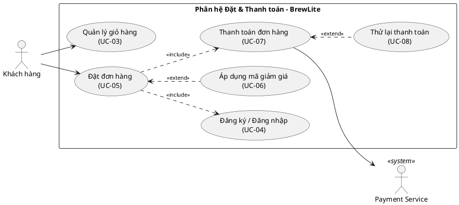

# Đặc tả Use-case trọng tâm: Đặt và thanh toán đơn hàng (UC-05, UC-07)

> Tệp: `docs/requirements/usecase-checkout.md`
> Task 1.3 | Dự án: BrewLite (PWA – Next.js, NestJS, PostgreSQL) | Liên kết: `srs.md` (v1.0)

## 1. Phạm vi và mục tiêu

Tài liệu mô tả chi tiết hai use-case có giá trị nghiệp vụ cao nhất của BrewLite:

- **UC-05 – Đặt đơn hàng (FR-05):** chuyển giỏ hàng thành đơn `PENDING_PAYMENT`, giữ tồn kho, áp mã giảm giá.
- **UC-07 – Thanh toán đơn hàng (FR-06):** thanh toán bằng Ví/Thẻ qua Payment Service, cập nhật đơn thành `PAID`.

## 2. Sơ đồ use-case

## 3. Đặc tả Use-case UC-05 – Đặt đơn hàng

| Mục | Nội dung |
|---|---|
| **Use-case name** | UC-05 – Đặt đơn hàng |
| **Actor** | Chính: Khách hàng (đã đăng nhập). Hỗ trợ: không có |
| **Description** | UC-05 đóng vai trò là **Quy trình thanh toán tổng thể (Checkout Flow)**, bao gồm (`<<include>>`) bước Thanh toán (UC-07). Khách chuyển các món trong giỏ hàng thành một đơn chính thức; hệ thống giữ phần đồ uống cho khách, áp mã giảm giá (nếu có), tính đúng số tiền phải trả, rồi tự động chuyển khách sang bước thanh toán để hoàn tất quy trình. |
| **Trigger** | Khách bấm **"Thanh toán"** tại giỏ hàng, rồi xác nhận đặt đơn. |
| **Preconditions** | 1. Khách đã đăng nhập và phiên đăng nhập còn hiệu lực (đăng nhập chưa quá 24 giờ), tài khoản không bị khóa. 2. Giỏ hàng có ít nhất một món, số lượng mỗi món từ 1 trở lên. 3. Các món, size và topping trong giỏ vẫn đang được cửa hàng phục vụ. |
| **Postconditions** | **Khi đặt đơn thành công:** đơn được tạo ở trạng thái `PENDING_PAYMENT`, lưu đúng tên món và giá tại thời điểm đặt; số lượng còn lại của từng món giảm đúng bằng số khách đã đặt; lượt dùng mã giảm giá (nếu có) tăng thêm 1; quản trị viên nhận thông báo có đơn mới. **Khi đặt đơn thất bại:** hủy bỏ tiến trình, không lưu thay đổi. Không có đơn mới, không món nào bị trừ số lượng, mã giảm giá không bị tính lượt dùng, giỏ hàng giữ nguyên. |
| **Normal Flow** | 1. Khách bấm "Thanh toán" tại giỏ hàng. 2. Hệ thống hiển thị lại các món và tổng tiền để khách kiểm tra. 3. Khách nhập mã giảm giá (nếu có, xem UC-06) và xác nhận đặt đơn. 4. Hệ thống kiểm tra phiên đăng nhập và tình trạng tài khoản của khách. 5. Hệ thống kiểm tra giỏ hàng: không trống, số lượng hợp lệ, món, size và topping còn phục vụ, topping phù hợp với nhóm món. 6. Hệ thống tính tiền theo giá niêm yết, phụ thu size và giá topping hiện hành của cửa hàng (không dùng số tiền khách đã thấy trước đó). 7. Hệ thống kiểm tra tồn kho theo thời gian thực và giữ lại số lượng đồ uống khách đặt. 8. Nếu có mã giảm giá, hệ thống kiểm tra mã còn dùng được, tính số tiền được giảm và trừ vào số tiền phải trả. 9. Hệ thống tạo đơn ở trạng thái `PENDING_PAYMENT` và lưu lại toàn bộ thay đổi. 10. Hệ thống gửi thông báo đơn mới cho quản trị viên. 11. Hệ thống hiển thị mã đơn, tổng tiền, số tiền được giảm, số tiền phải trả và số điểm dự kiến nhận được (cứ 10.000đ phải trả được 1 điểm, tính theo phần nguyên). 12. Hệ thống tự động kích hoạt quy trình Thanh toán (UC-07) do có quan hệ include. Khách hàng không cần bấm thêm nút "Thanh toán" nào nữa để chuyển sang bước này. Trạng thái `PENDING_PAYMENT` lúc này là trạng thái chờ xử lý giao dịch với cổng thanh toán. |
| **Exceptions** | **Exception 1 – at step 7 (món hết hàng hoặc có người khác vừa đặt trước):** 7a. Nếu số lượng còn lại không đủ, hoặc có khách khác vừa đặt món đó trước vài giây, hệ thống kiểm tra lại số lượng còn lại. 7b. Nếu vẫn không đủ, hệ thống từ chối cả đơn, hủy bỏ tiến trình, không lưu thay đổi (không món nào bị trừ số lượng). 7c. Hệ thống thông báo lỗi hết hàng, nêu rõ món nào và còn bao nhiêu phần (hoặc món vừa hết / thay đổi số lượng). Khách quay về giỏ hàng để chỉnh lại.  **Exception 2 – at step 4 (chưa đăng nhập hoặc phiên đăng nhập hết hạn):** 4a. Hệ thống yêu cầu khách đăng nhập (hoặc đăng nhập lại). 4b. Sau khi đăng nhập, khách quay lại bước thanh toán và giỏ hàng vẫn còn nguyên.  **Exception 3 – at step 4 (tài khoản bị khóa):** 4c. Hệ thống từ chối đặt đơn và hướng dẫn khách liên hệ quản trị viên.  **Exception 4 – at step 5 (giỏ hàng hoặc lựa chọn không hợp lệ):** 5a. Nếu giỏ trống, số lượng sai, món hoặc nhóm món đã ngừng bán, size hoặc topping đã ngừng phục vụ, hoặc topping không phù hợp với nhóm món, hệ thống không tạo đơn. 5b. Hệ thống nêu rõ lựa chọn nào không hợp lệ và đề nghị khách kiểm tra lại giỏ hàng.  **Exception 5 – at step 8 (mã giảm giá không dùng được):** 8a. Nếu mã không tồn tại, đã bị khóa, chưa đến ngày áp dụng, đã hết hạn, hết lượt dùng hoặc đơn chưa đạt giá trị tối thiểu, hệ thống báo rõ lý do và không giảm giá. 8b. Khách có thể tiếp tục đặt đơn với giá gốc hoặc nhập mã khác. |
| **Alternative Flows** | **Alternative 1 – at step 3 (khách có mã giảm giá – UC-06):** 3a. Khách nhập mã còn hiệu lực, còn lượt dùng và đơn đạt giá trị tối thiểu. Hệ thống hiển thị số tiền được giảm và số tiền phải trả mới. Với mã giảm theo phần trăm, mức giảm không vượt quá mức giảm tối đa của mã; mức giảm cũng không vượt quá tổng tiền đơn.  **Alternative 2 – at step 3 (khách muốn đổi món):** 3b. Khách quay lại giỏ hàng, thêm bớt món rồi bấm "Thanh toán" lại từ bước 1. |
| **Requirements** | FR-05; NFR-02, NFR-05; AC-05.1 → AC-05.7, AC-05.13 → AC-05.16, AC-N05.1, AC-N05.2. Phần mã giảm giá (UC-06): AC-05.8 → AC-05.12 |

## 4. Đặc tả Use-case UC-07 – Thanh toán đơn hàng

| Mục | Nội dung |
|---|---|
| **Use-case name** | UC-07 – Thanh toán đơn hàng |
| **Actor** | Chính: Khách hàng (đã đăng nhập). Hỗ trợ: Dịch vụ thanh toán (bên xử lý giao dịch Ví/Thẻ; giai đoạn đầu là bản mô phỏng) |
| **Description** | Khách trả tiền cho đơn bằng Ví hoặc Thẻ để cửa hàng bắt đầu pha chế. Dù khách bấm nút thanh toán nhiều lần, khách chỉ bị tính tiền một lần. **Khách hàng có thể thanh toán lại từ màn hình "Đơn của tôi" (UC-08).** |
| **Trigger** | Khách chọn Ví hoặc Thẻ và bấm **"Xác nhận thanh toán"** (ngay sau khi đặt đơn, hoặc từ mục "Đơn của tôi"). |
| **Preconditions** | 1. Khách vào UC-07 thông qua UC-05 (được kích hoạt tự động) hoặc thông qua chức năng Thử lại thanh toán (UC-08). 2. Đơn cần thanh toán là đơn của chính khách. 3. Đơn đang ở trạng thái `PENDING_PAYMENT` hoặc `PAYMENT_FAILED`. 4. Khách đã chọn phương thức thanh toán là Ví hoặc Thẻ. |
| **Postconditions** | **Khi thanh toán thành công:** đơn chuyển sang `PAID`; số tiền ghi nhận đúng bằng số tiền phải trả; khách nhận mã giao dịch; điểm tích lũy được cộng (cứ 10.000đ được 1 điểm, tính theo phần nguyên); giỏ hàng được làm trống; quản trị viên nhận thông báo đơn đã thanh toán và đơn xuất hiện trong danh sách chờ pha chế. **Khi thanh toán thất bại:** đơn chuyển sang `PAYMENT_FAILED`; khách không bị trừ tiền và không được cộng điểm; giỏ hàng và số lượng đồ uống đã giữ không đổi; quản trị viên nhận thông báo thanh toán thất bại; khách có thể thử lại hoặc đổi phương thức (UC-08). **Khi khách bấm thanh toán nhiều lần:** chỉ có một giao dịch được ghi nhận và khách nhận lại cùng một kết quả. |
| **Normal Flow** | 1. Khách chọn Ví hoặc Thẻ và bấm "Xác nhận thanh toán". 2. Hệ thống kiểm tra phiên đăng nhập và kiểm tra đơn có đúng là của khách. 3. Hệ thống kiểm soát việc bấm nút thanh toán nhiều lần: nếu đây là lần bấm đầu tiên cho lần thanh toán này thì tiếp tục xử lý. 4. Hệ thống kiểm tra đơn đang ở trạng thái cho phép thanh toán, khách đã chọn phương thức được hỗ trợ và số tiền thanh toán đúng bằng số tiền phải trả. 5. Hệ thống gửi yêu cầu thanh toán sang dịch vụ thanh toán. 6. Dịch vụ thanh toán xử lý giao dịch và báo thành công kèm mã giao dịch. 7. Hệ thống chuyển đơn sang `PAID`, ghi nhận giao dịch, cộng điểm tích lũy và làm trống giỏ hàng. 8. Hệ thống ghi nhớ kết quả của lần thanh toán này và gửi thông báo đơn đã thanh toán cho quản trị viên. 9. Hệ thống hiển thị màn hình xác nhận với mã đơn, trạng thái và mã giao dịch. 10. Khách theo dõi tiến độ đơn cho đến khi nhận đồ uống tại quầy (FR-07). |
| **Exceptions** | **Exception 1 – at step 5 hoặc 6 (thanh toán lỗi hoặc quá thời gian chờ – UC-08):** 6a. Dịch vụ thanh toán từ chối, hoặc không phản hồi trong thời gian quy định. 6b. Hệ thống chuyển đơn sang `PAYMENT_FAILED`, không cộng điểm, không làm trống giỏ hàng và thông báo cho quản trị viên. 6c. Hệ thống báo lỗi thanh toán bằng tiếng Việt, nêu nguyên nhân và gợi ý khách thử lại hoặc đổi phương thức. 6d. Nếu chưa biết giao dịch đã thành công hay chưa (do quá thời gian chờ), hệ thống kiểm tra lại với dịch vụ thanh toán trước khi cho khách thử lại, để không tính tiền hai lần. 6e. Khi khách thử lại, hệ thống xử lý như một lần thanh toán mới, bắt đầu lại từ bước 1.  **Exception 2 – at step 3 (khách bấm thanh toán nhiều lần):** 3a. Nếu lần thanh toán trước đã có kết quả, hệ thống không xử lý lại mà hiển thị đúng kết quả đó cho khách. 3b. Nếu lần thanh toán trước vẫn đang xử lý, hệ thống thông báo giao dịch đang được xử lý, đề nghị khách chờ và không bấm lại. 3c. Hệ thống không bao giờ gửi hai yêu cầu trừ tiền cho cùng một lần thanh toán.  **Exception 3 – at step 2 (chưa đăng nhập, phiên hết hạn hoặc sai quyền):** 2a. Nếu chưa đăng nhập hoặc phiên đăng nhập hết hạn, hệ thống từ chối và yêu cầu khách đăng nhập. 2b. Nếu đơn không phải của khách, hệ thống từ chối và không hiển thị thông tin đơn.  **Exception 4 – at step 4 (đơn không thể thanh toán):** 4a. Nếu đơn đang ở trạng thái `PAID`, hệ thống từ chối và báo đơn đã được thanh toán. 4b. Nếu đơn đang ở trạng thái `CANCELLED` hoặc `COMPLETED`, hệ thống từ chối và báo đơn không thể thanh toán.  **Exception 5 – at step 4 (phương thức hoặc số tiền không hợp lệ):** 4c. Nếu khách chưa chọn phương thức hoặc chọn phương thức không được hỗ trợ, hệ thống yêu cầu chọn Ví hoặc Thẻ. 4d. Nếu số tiền thanh toán thấp hơn số tiền phải trả, hệ thống từ chối giao dịch.  **Exception 6 – at step 7 (đơn vừa bị thay đổi):** 7a. Nếu trong lúc thanh toán, quản trị viên vừa hủy đơn, hệ thống hủy bỏ tiến trình, không lưu thay đổi và báo khách đơn đã bị thay đổi. |
| **Alternative Flows** | **Alternative 1 – at step 1 (khách đổi phương thức):** 1a. Khách đổi giữa Ví và Thẻ trước khi xác nhận. Luồng tiếp tục bình thường.  **Alternative 2 – at step 1 (thanh toán lại từ "Đơn của tôi" – UC-08):** 1b. Khách có thể thanh toán lại bằng cách vào "Đơn của tôi" (Lịch sử đơn hàng), mở đơn đang `PENDING_PAYMENT` hoặc `PAYMENT_FAILED` và bấm "Thanh toán lại" (kích hoạt UC-08). Luồng bắt đầu từ bước 1. |
| **Requirements** | FR-06; NFR-02, NFR-05; AC-06.1 → AC-06.13 (trong đó AC-06.5, AC-06.6 thuộc UC-08), AC-07.7, AC-N05.3 |

## 5. Máy trạng thái đơn hàng (State Machine)

Tên trạng thái trong mã nguồn đối chiếu với tên trong SRS (Mục 3):

| Mã trạng thái | Tên trong SRS |
|---|---|
| `PENDING_PAYMENT` | Chờ thanh toán |
| `PAYMENT_FAILED` | Thanh toán thất bại |
| `PAID` | Đã thanh toán |
| `PREPARING` | Đang pha chế |
| `READY` | Sẵn sàng |
| `COMPLETED` | Hoàn tất |
| `CANCELLED` | Đã hủy |

**Bảng chuyển trạng thái:**

| Từ trạng thái | Sang trạng thái | Điều kiện / Tác nhân | Hệ quả |
|---|---|---|---|
| (tạo mới) | `PENDING_PAYMENT` | UC-05 thành công | Trừ kho, tăng lượt dùng mã |
| `PENDING_PAYMENT` | `PAID` | Payment Service báo thành công | Cộng điểm, làm trống giỏ |
| `PENDING_PAYMENT` | `PAYMENT_FAILED` | Payment lỗi hoặc timeout | Không cộng điểm |
| `PAYMENT_FAILED` | `PENDING_PAYMENT` | Khách thanh toán lại | Bắt đầu lần thanh toán mới |
| `PAYMENT_FAILED` | `PAID` | Khách thanh toán lại và Payment báo thành công | Cộng điểm, làm trống giỏ (AC-06.1, AC-06.6) |
| `PENDING_PAYMENT`, `PAYMENT_FAILED` | `CANCELLED` | Admin hủy | Hoàn kho, hoàn lượt dùng mã |
| `PENDING_PAYMENT`, `PAYMENT_FAILED` | `CANCELLED` | **Tự động hủy đơn:** hệ thống (System) tự hủy khi đơn quá thời hạn thanh toán quy định mà chưa chuyển sang `PAID` | Hoàn kho, hoàn lượt dùng mã |
| `PAID` | `CANCELLED` | Admin hủy khi chưa pha chế | Hoàn kho, hoàn mã, **thu hồi điểm** |

- **Chuyển trạng thái không hợp lệ** (ví dụ `PAID → PAYMENT_FAILED`, `CANCELLED → PAID`) bị từ chối, trạng thái giữ nguyên.
- Mọi lần chuyển trạng thái được ghi lại (thời gian, người/hệ thống thực hiện) để tra cứu.
- **`PENDING_PAYMENT` là trạng thái vi mô (transient state):** xảy ra ngay sau khi khách bấm Đặt đơn và kéo dài trong lúc hệ thống chờ phản hồi từ Payment Service. Nếu khách tắt app giữa chừng, hệ thống vẫn giữ đơn ở trạng thái này để khách có thể vào "Đơn của tôi" thanh toán tiếp (UC-08). Cách hiểu này giải thích vì sao UC-05 vẫn `<<include>>` UC-07 nhưng đơn vẫn có một trạng thái chờ.
- **Tự động hủy đơn:** chỉ áp dụng cho đơn chưa thanh toán (`PENDING_PAYMENT`, `PAYMENT_FAILED`). Đơn đã `PAID` không bị hệ thống tự hủy; muốn hủy phải do Admin thực hiện theo điều kiện ở bảng trên. Kết quả hoàn kho và hoàn lượt dùng mã giống trường hợp Admin hủy; lịch sử chuyển trạng thái ghi tác nhân là hệ thống (System).
- Các trạng thái sau `PAID` (`PREPARING`, `READY`, `COMPLETED`) thuộc FR-08, ngoài phạm vi tài liệu này. Đơn đã `PREPARING` trở đi thì Admin không được hủy (AC-08.9).

## 6. Truy vết yêu cầu và tiêu chí chấp nhận

**Bảng kịch bản kiểm thử:**

| Kịch bản kiểm thử | Mã AC | Kết quả mong đợi |
|---|---|---|
| Đặt đơn hợp lệ, đủ hàng | AC-05.1, 05.3 | Đơn `PENDING_PAYMENT`, kho giảm đúng |
| Giá tính từ DB, không tin client | AC-05.2 | Số tiền theo giá hiện hành |
| Món không đủ số lượng | AC-05.4 | `409`, từ chối cả đơn, không món nào bị trừ kho |
| Món / size / topping ngừng phục vụ, giỏ trống | AC-05.5, 05.6, 05.7 | Từ chối, nêu rõ lựa chọn không hợp lệ |
| Hai khách cùng đặt món còn 1 phần | AC-05.13, N05.2 | Một thành công, một `409`; kho = 0 |
| Tài khoản bị khóa đặt đơn | AC-05.14 | Từ chối đặt đơn |
| Quản trị viên nhận thông báo đơn mới | AC-05.15 | Có thông báo đơn mới |
| Hiển thị điểm dự kiến khi đặt đơn | AC-05.16 | 1 điểm / 10.000đ, tính theo phần nguyên |
| Áp mã giảm giá hợp lệ / có trần | AC-05.8, 05.9, 05.10 | Tiền giảm đúng, không vượt trần/tổng tiền |
| Mã không dùng được | AC-05.11 | Báo rõ lý do, không giảm giá |
| Đơn có mã được tạo | AC-05.12 | Lượt dùng mã tăng 1 |
| Tạo đơn bị gián đoạn giữa chừng | AC-N05.1 | Không đơn dở dang, kho không trừ sai |
| Thanh toán thành công | AC-06.1, 06.2, 06.3, 06.4 | `PAID`, cộng điểm, giỏ trống, Admin thấy đơn chờ pha chế |
| Thanh toán thất bại | AC-06.5, 06.13 | `PAYMENT_FAILED`, không cộng điểm, Admin nhận thông báo |
| Thử lại sau thất bại | AC-06.6, 07.7 | Thanh toán mới, có thể thành `PAID` |
| Bấm xác nhận nhiều lần cùng key | AC-06.7, N05.3 | Chỉ 1 giao dịch, cùng kết quả |
| Thanh toán đơn đã `PAID` | AC-06.8 | Từ chối, báo đơn đã được thanh toán |
| Thanh toán đơn `CANCELLED` / `COMPLETED` | AC-06.9 | Từ chối, báo đơn không thể thanh toán |
| Số tiền thấp hơn số tiền phải trả | AC-06.10 | Từ chối giao dịch |
| Chưa chọn / chọn sai phương thức | AC-06.11 | Yêu cầu chọn Ví hoặc Thẻ |
| Thanh toán đơn của người khác | AC-06.12, N02.2 | `403` |

**Bảng truy vết use-case:**

| Use-case | Yêu cầu chức năng | Yêu cầu phi chức năng |
|---|---|---|
| UC-05 Đặt đơn hàng | FR-05 | NFR-02, NFR-05 |
| UC-06 Áp dụng mã giảm giá | FR-05 | NFR-05 |
| UC-07 Thanh toán đơn hàng | FR-06 | NFR-02, NFR-05 |
| UC-08 Thử lại thanh toán | FR-06 | NFR-05 |
